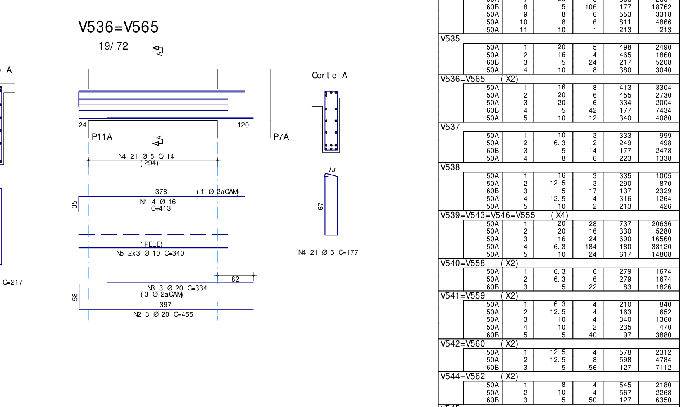

> HISTÓRICO SUPERADO em 06/10/2026: o comprimento de verificação foi corrigido pelo engenheiro para lb_ef=L_apoio−cobrimento=21,5 cm. Este arquivo conserva o ensaio anterior de 21 cm e não representa a conclusão vigente.

# V536=V565 — validação da ancoragem positiva no apoio esquerdo

06/10/2026. **A área positiva que chega ao apoio é suficiente nas duas vigas; o comprimento de ancoragem não atende no ensaio com 21 cm disponíveis e α=0,7.** V536 exige 24,203 cm e V565 exige 21,270 cm. A conclusão refere-se às entradas e ao procedimento abaixo; não constitui aprovação global das vigas nem inspeção independente da geometria da dobra.

## 1. Objetivo e implementação validada

Validar o caso real usando as APIs públicas atuais `Concretopy.calcular_armadura_positiva_apoio` e `Concretopy.verificar_ancoragem_positiva_apoio`. A primeira retorna demanda A/B/C para um único par Mk/Vk; a segunda compara área e comprimento e retorna os diagnósticos separados.

Não foi criada nova verificação estrutural genérica no engineering-assistant. O script deste ensaio apenas seleciona entradas documentais, chama as APIs, compara os dois resultados e registra auditoria. Nenhuma equação de resistência, fbd, lb ou al foi reimplementada, e Concretopy não foi alterado.

## 2. Fontes e decisões do engenheiro

- [Detalhamento documental](../../analises/pranchas/V536_V565_detalhamento_prancha.json): PDF `RMP-EST-EX-1349-VIG-R00 - Copia.PDF`, página 1, caminho integral e SHA-256 registrados no JSON. Recorte abaixo.
- Esforços separados de V536 e V565: arquivos `*_tqs_positions.json`, `*_tqs_raw.json` e `*_beam_mapping.json` em `analises/pranchas`, extraídos de `C:\TQS\24-155-COLLINE-RESIDENCIAL-R60\DIFERENCIADO\VIGAS`. As séries conservam os identificadores das fontes TQS.
- [Auditoria anterior de geometria/camadas](V536_V565_N3_scaling_check.md), reutilizada como entrada rastreável, sem modificar seus resultados.
- Procedimento de revisão: [Skill reinforcement-review](../../.agents/skills/reinforcement-review/SKILL.md), referências de vigas e aderência.
- Contratos vigentes: [demanda de apoio](../../../concretopy/docs/armadura_apoio.md), [ancoragem](../../../concretopy/docs/ancoragem.md), [API pública](../../../concretopy/docs/api_publica.md) e [auditoria da refatoração](../../../concretopy/.codex/analises/apoio_refatoracao_ancoragem_extremidade.md).

Decisões expressas nesta sessão:

1. Analisar Mk positivo com o módulo de Vk mínimo e, separadamente, Mk=0 com Vk máximo em módulo.
2. Usar **S1, no eixo do apoio esquerdo** para os esforços do apoio.
3. Utilizar **α=0,7** para o gancho. A API recebe `gancho_valido=True` como entrada do engenheiro; não houve verificação independente de todas as condições físicas da dobra.

As combinações são pares de envoltórias escolhidos pelo engenheiro. Não se afirma que constituem esforços concomitantes de uma combinação identificada do modelo.



## 3. Geometria e barras efetivamente no apoio

Seção retangular adotada **19×72 cm**; apoio esquerdo **24 cm**; vão livre **294 cm**. V536 está associada a P11A, V565 a P12B, pelo contexto de detalhamento compartilhado e pelos registros ordenados de cada viga. Quantidades são por viga, sem multiplicar pela chamada X2.

A origem comum é o eixo esquerdo: face interna x=0,120 m, face externa x=−0,120 m. S1 é x=0.

| Marca positiva | Composição | Intervalo comum | Participa no apoio esquerdo? |
|---|---|---|---|
| N2 | 3Ø20, primeira camada, dobra esquerda de 58 cm | −0,090 a 3,880 m | Sim |
| N3 | 3Ø20, segunda camada, reta | 0,540 a 3,880 m | Não |

N3 começa 42 cm depois da face interna esquerda. A composição positiva do apoio é somente **N2**, As efetiva=**9,424777961 cm²**. N1 superior e N5 de pele não foram incorporadas à resistência positiva adotada.

## 4. Comprimento disponível

A posição documental da extremidade direita é 294+82=376 cm, referida à face interna esquerda. A projeção horizontal da N2 é 397 cm: início=376−397=−21 cm. Assim, o ensaio utiliza **L disponível=21 cm**, entre face interna e extremidade/posição documental da dobra.

Esse valor reutiliza a interpretação dimensional já auditada no fixture. Não se soma o ramo vertical de 58 cm, não se usa o comprimento desenvolvido C=455 cm e não se desconta cobrimento novamente de uma projeção já derivada do detalhamento. Não houve correção por raio de dobra nem confirmação independente da convenção de cota até tangente/eixo da curva. Eventual revisão dessa interpretação exige recalcular o resultado; isso é particularmente relevante na V565.

O pedido do engenheiro confirmou α=0,7, não uma inspeção de raio/pino, confinamento ou cobrimento local da dobra.

## 5. Materiais, seção e alturas úteis

Reutilizados da auditoria anterior: C40, CA50/fyk=500 MPa; γf=1,4, γc=1,4, γs=1,15; cobrimento TQS 2,5 cm e parâmetro de estribo Ø5. Os conflitos documentais de materiais/seção permanecem nos arquivos de origem; o critério de resolução anterior foi mantido. Não se creditou mesa colaborante.

- **d do apoio=68 cm**, centro da N2, única camada positiva no apoio.
- **d do vão=66 cm**, centroide resistente N2+N3 nas regiões de maior momento, retornado pela verificação de flexão anterior; N2 d=68 e N3 d=64, áreas iguais.
- Linha neutra da configuração real N2: x=**11,100660541 cm**.
- Braço usado pela nova API: z=**62,449669730 cm**, conforme simplificação de engenharia `d−x/2` formalizada no contrato.

A regra de d=66 cm antes do corte da N3 não foi transportada ao apoio. O d=68 cm de al neste ensaio vem da configuração real das barras do apoio, analisada pela própria API de apoio. Não há força normal de tração especial documentada: Nd=0 é hipótese registrada do ensaio.

## 6. Esforços e pares de cálculo

Esforços característicos, S1 x=0. O sinal original de Vk permanece no JSON; a API recebe sua magnitude em kN. Momentos são convertidos uma única vez: kN.m×100=kN.cm.

| Entrada | V536 | V565 |
|---|---:|---:|
| Mk positivo S1 (kN.m) | 22,820075 | 19,662333 |
| Vk envoltória mínima S1, com sinal (kN) | −33,538743 | −25,516903 |
| Vk envoltória máxima S1, com sinal (kN) | +123,603017 | +113,982693 |
| Mk negativo S1 (kN.m) | −36,598418 | −32,881697 |
| Máximo positivo amostrado do vão (kN.m) | 317,745267 | 284,147684 |

P1: Mk positivo da tabela e módulo da envoltória mínima. P2: Mk=0 por regra do engenheiro e maior módulo entre as duas envoltórias na S1. Para ambos os casos governa o Vk positivo no P2.

**Não foi utilizado o máximo de cortante do vão da verificação de escalonamento.** Na V536, esse máximo seria 125,152467 kN na S2 x=0,273 m; o apoio usa 123,603017 kN na S1.

O máximo positivo do vão é o maior ponto da representação amostrada, S13 x=3,276 m; não é declarado máximo estrutural exato. Esse ponto está dentro do apoio direito, e é mantido no domínio TQS adotado pelo workflow anterior, sem extrapolação ou mudança dos goldens.

## 7. Demanda A/B/C e decalagem

A, B e C neste relatório são as condições da **demanda no apoio**; não são as duas condições A/B do escalonamento da N3.

| Viga / par | As A (cm²) | As B (cm²) | Fsd B (kN) | al final (cm) | As C1 (cm²) | Demanda final (cm²) |
|---|---:|---:|---:|---:|---:|---:|
| V536 / P1 | 2,448720 | 2,256585 | 98,112404 | 68 | 5,917168 | 5,917168 |
| V536 / P2 | Não aplicável | 3,980017 | 173,044223 | 68 | 5,917168 | 5,917168 |
| V565 / P1 | 2,448720 | 1,835464 | 79,802787 | 68 | 5,200058 | 5,200058 |
| V565 / P2 | Não aplicável | 3,670243 | 159,575770 | 68 | 5,200058 | 5,200058 |

A inclui a armadura mínima retornada pelo dimensionador. Mk=0 torna A não aplicável, sem fabricar uma demanda A nula como se fosse um dimensionamento completo.

C1 governa em ambas as chamadas e ambas as vigas. Razões |Mk negativo apoio|/Mk positivo máximo: **0,115182** e **0,115720**, abaixo de 0,5. O dimensionador do vão retorna As=**17,751504** e **15,600174 cm²**; a API retorna C1 como um terço desses valores. Os dois pares empatam na demanda final por compartilhar C1; os dois são preservados.

Concretopy retorna Vc0=**136,001913 kN**. P1 tem Vsd≤Vc0; P2 tem Vsd>Vc0. No P2, al_base=**158,831983 cm** na V536 e **230,152247 cm** na V565, mas **al final limitado=68 cm** em ambas. É esse al final que alimenta B. Não se soma al ao comprimento de ancoragem desta API.

## 8. Aderência e ancoragem

Centro físico da N2: y=h−d=72−68=**4 cm da face inferior**. Pela regra confirmada para barras horizontais, a fronteira para h=72 é y=42 cm: **boa aderência**. Não foi reutilizada a posição y=8 cm da N3. A classificação corresponde ao trecho horizontal analisado; a aceitação do gancho continua entrada do engenheiro.

Concretopy retorna fbd=**3,947423947 MPa**, lb básico=**55,071689104 cm**, lb mínimo=**20 cm**. Para esta API de apoio, verifica-se **lb necessário**, com áreas reais e α=0,7; não o lb básico isolado utilizado na condição B do escalonamento.

| Resultado com gancho α=0,7 | V536 | V565 |
|---|---:|---:|
| As calculada a ancorar (cm²) | 5,917168 | 5,200058 |
| As efetiva N2 (cm²) | 9,424778 | 9,424778 |
| lb necessário (cm) | **24,203000** | **21,269804** |
| Comprimento disponível adotado (cm) | 21,000000 | 21,000000 |
| Déficit de comprimento (cm) | **3,203000** | **0,269804** |
| Área suficiente | Sim | Sim |
| Comprimento ≥ lb mínimo | Sim | Sim |
| Comprimento suficiente para lb necessário | **Não** | **Não** |
| `atende` da API | **false** | **false** |

A V565 não pode ser aprovada por arredondar 21,269804 cm para 21 cm antes da comparação. Seu déficit é aproximadamente **2,698 mm**, tornando a interpretação geométrica relevante.

Como sensibilidade, sem crédito ao gancho (α=1), os comprimentos necessários seriam **34,575715 cm** e **30,385435 cm**, também superiores a 21 cm. Esse cenário não substitui a decisão α=0,7.

## 9. Cálculo inverso e limites de interpretação

Mantidos material, Ø20, boa aderência, α=0,7 e L=21 cm, a API retorna:

| Grandeza matemática | V536 | V565 |
|---|---:|---:|
| As corrigida (cm²) | 10,862281 | 9,545866 |
| As adicional em relação à N2 (cm²) | 1,437503 | 0,121088 |

São resultados inversos do procedimento, **não dimensionamento de grampos nem proposta de alteração da prancha**. Mudar número de barras, bitola, camadas ou geometria exige nova análise completa, inclusive de d/x/z, demanda e ancoragem. Não foi escolhida solução construtiva nesta validação.

## 10. Provenance e reprodução

- [Script de reprodução e validação](../../analises/pranchas/validar_v536_v565_apoio_esquerdo.py).
- [Resultado V536](../../analises/pranchas/V536_left_support_anchorage_check.json).
- [Resultado V565](../../analises/pranchas/V565_left_support_anchorage_check.json).
- [Auditoria dos testes e hashes](../../analises/pranchas/V536_V565_left_support_anchorage_validation.json).

Cada resultado preserva amostras com seção/x/série/sinal/unidade/fontes, pares, objetos completos Concretopy, governantes/empates, geometria, regra de aderência, interpretação do comprimento, decisões do engenheiro, limitações e hashes dos arquivos de entrada e implementações.

Na raiz do engineering-assistant, com Python 3.10 e o Concretopy local irmão:

```powershell
python -B analises/pranchas/validar_v536_v565_apoio_esquerdo.py
```

O script escreve somente seus novos resultados de apoio/auditoria, sem regenerar os fixtures ou os goldens de escalonamento anteriores.

## 11. Verificação da integração e regressões

**232 testes existentes aprovados**: extrator_lst 39; beam_model 30; beam_mapping 34; reinforcement_checks 129. Preservadas as regressões V501, V1001, V536/V565, grouped mapping e interpolação.

**21 asserções de integração aprovadas**, incluindo composição do apoio, conversão de unidades, preservação do sinal de Vk mínimo, seleção local S1, Mk=0 no segundo par, C1 governante/empate, al limitado, área e comprimento separados, α/minimum, cálculo inverso e comparação sem arredondamento.

**125 arquivos protegidos permaneceram com SHA-256 idêntico**, incluindo implementações existentes do assistente, fixtures/goldens anteriores, Skill/referências e código/documentação do Concretopy. Nenhum resultado anterior foi alterado. Os novos números são resultados de uma verificação distinta, no apoio.

A suíte pytest do Concretopy não foi reexecutada nesta etapa: pytest não está instalado nos interpretadores locais consultados. A auditoria da implementação registra 405 testes anteriores; essa evidência histórica não é apresentada como execução desta validação. As duas APIs reais foram exercitadas diretamente no ensaio e nas asserções de integração.

## 12. Pendências e conclusão técnica

O cálculo de área/comprimento foi executado com as escolhas do engenheiro para pares, S1 e α=0,7 e com a interpretação documental de L=21 cm. Nesse procedimento, **a ancoragem positiva esquerda não atende em nenhuma das duas vigas por comprimento insuficiente**, embora a área de N2 seja suficiente.

Não foi certificado raio/pino de dobra, cobrimento local do gancho, confinamento no interior do apoio ou todos os requisitos de detalhamento. Ø5 é parâmetro de geometria herdado da seção auditada, não comprovação de estribos distribuídos dentro do pilar. Não se verificou cisalhamento completo, negativos, suspensão, grampos, apoio direito ou aprovação global da viga. A boa condição de escalonamento da N3 nos goldens permanece válida e independente deste resultado de apoio.

Os contratos citam NBR 6118:2023, itens 18.3.2.4 e 9.4.2.4/9.4.2.5; nesta etapa foram consultados os contratos e decisões formalizadas do projeto, não o texto integral da norma. Não se adicionou interpretação normativa para resolver a geometria da dobra.

Contradição documental identificada: `al_shear_selection.md` ainda deixa pendente a definição espacial geral da região de apoio. A decisão específica **S1** nesta sessão resolve o presente ensaio; não foi convertida silenciosamente em regra universal nem aplicada ao escalonamento. Relatórios antigos da API com B1/B2 internos são históricos; a auditoria mais recente da refatoração documenta a API atual de um par por chamada, utilizada aqui.
