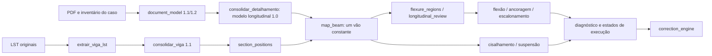

# Auditoria prévia — Etapa 1

Registro anterior à implementação. Não altera métodos de dimensionamento.

## Dependências existentes

| Componente | Contrato existente | Lacuna encontrada | Intervenção prevista |
|---|---|---|---|
| extração PDF do caso | drawing_inventory, rótulos, caixas, traços, instance | extração gráfica específica; sem conciliação de tabela/corte/elevação | leitor documental por zonas declaradas, observações com origem; não converter escala gráfica em cota |
| document_model e consolidar_detalhamento | posição por marca, camadas e coordenadas em cm | marca confundida com ocorrência; seção geral | extensão opcional do contrato, preservando transformação antiga |
| extrair_viga_lst | normalização com texto/linha/arquivo | regex geométrica ignora 1B/2B/4B | preservar token e tipo de vão, sem inferir orientação |
| consolidar_viga | consenso, conflitos, unidades, fontes | tipo B não alcança consumidor | propagar classificação documental e conflito |
| map_beam | um vão, transformação explícita cm/m | não admite geometria variável/múltiplos vãos | manter restrição; preparar segmentos constantes pelo contrato físico, sem liberar cálculos inválidos |
| termination_geometry | face externa de pilar terminal não cotado | convenção precisa ficar distinguível de prova documental | reutilizar sem alterar regra |
| flexure_regions | partição por barras e geometria transversal | posições únicas e conectividade física insuficiente | projetar ocorrências com identificador próprio |
| longitudinal_review | seção constante por chamada | seção variável não pode usar seção média | preparação de chamadas locais constantes; limites explícitos |
| verificadores e diagnóstico | estados técnicos e de execução separados | pendência documental pode contaminar viga inteira | preflight por controle/intervalo, guardas de execução e entradas rastreáveis |
| correction_engine | recebe resultados de controles | propostas não solicitadas | bloquear dependências pendentes; não executar geração de propostas nesta etapa |

Baseline antes das alterações: beam_model 30, extrator_lst 39 e beam_mapping 57 testes aprovados (126). Há alterações anteriores no repositório, preservadas.

## Decisões e limites

Fontes discordantes permanecem discordantes; ausência de extração não prova ausência de aço. V623: usuário confirmou corte da elevação na plotagem; N2 = 4Ø16 C464 consta em tabela/corte. Não se deduz sua posição longitudinal.

As verificações continuam usando as envoltórias TQS. Não se exigem combinações concomitantes. Não se implementam seção T, pinos, trajetórias curvas ou interferência com armaduras de pilares como requisitos obrigatórios. Preserva-se a ancoragem simplificada e a convenção de término na face externa do pilar terminal. Não haverá edição de pranchas, propostas de correção ou alteração do Concretopy.
