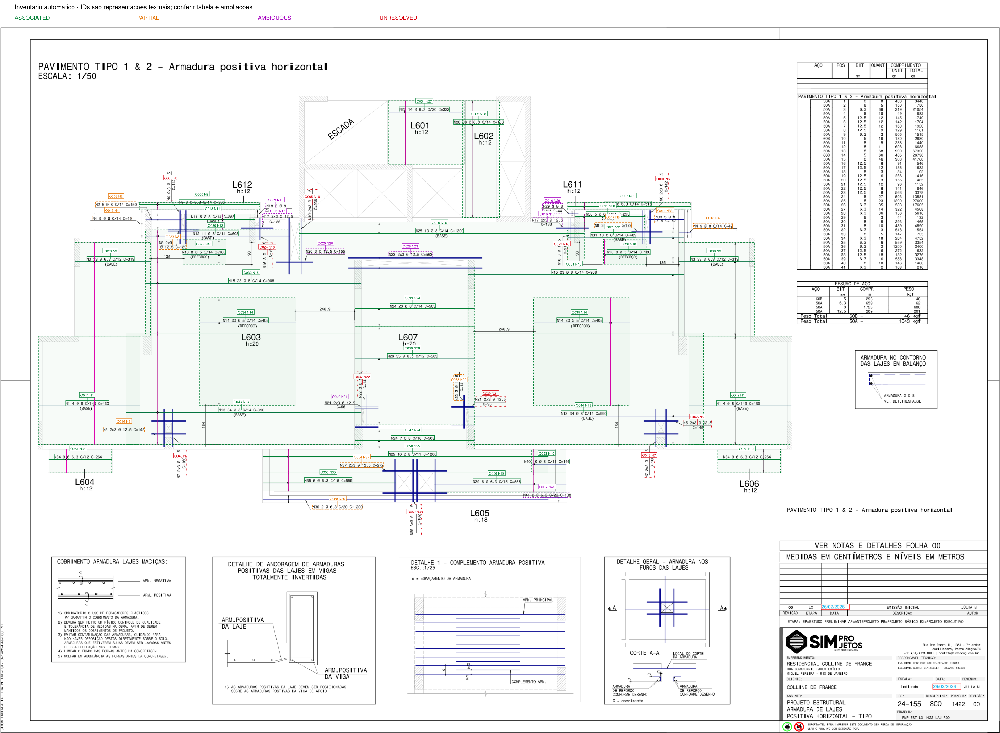

# Leitura automática das armaduras: inventário e associações

Prancha: `RMP-EST-LO-1422-LAJ-R00.PDF`, página 1, R00. Estudo documental, sem
qualquer cálculo ou verificação resistente. SHA-256:
`3eae69c055bc2b9e161c7767915f2682f9e7b53651dae073d046ecd0ddb45662`.

**O algoritmo detectou 59 representações textuais de armaduras, de 41 posições,
sem seleção prévia das marcas.** Foram produzidas 30 associações completas pelos
critérios experimentais, 10 parciais, 8 ambíguas e 11 não resolvidas. Uma amostra
dirigida de seis associações completas foi sustentada pela inspeção visual do
assistente. Isso não equivale a validação independente pelo engenheiro ou taxa de
acerto da prancha.

## Auditoria e compatibilidade

Antes de modificar código, foram consultados os três arquivos Python, os testes,
o README, o relatório da primeira prova, o resultado N26 e o inventário vetorial.
Mantidos os princípios documentais da skill reinforcement-review: distinguir
extração, interpretação gráfica, hipótese e confirmação. Nenhuma regra resistente
ou convenção de vigas foi transportada para este procedimento.

| Função existente | Aproveitamento e limite identificado |
|---|---|
| `geometry.extract_page` | Reutilizada integralmente: textos, coordenadas/direções, caminhos e segmentos com IDs. Não reconhece semântica CAD. |
| `geometry.parse_call` | Preservada; exige uma linha completa, espaçamento e quantidade simples. Novo `parse_extended` trata o inventário com campos ausentes, espaçamento opcional e fatores impressos. |
| `geometry.arrow_wings` | Reutilizada no reconhecimento das faixas; eixos horizontais são rotacionados para seu sistema vertical. Ainda exige duas asas em cada ponta. |
| `geometry.associate` | Preservada integralmente para o experimento N26. Sua exigência de cobertura completa da chamada, marcador e igualdade aproximada C/projeção não serve a todos os casos da folha. |
| `run_case.py` e testes N26 | Preservados sem alterações. A regressão nova também compara IDs e os quatro vértices N26, exatamente iguais aos anteriores. |
| `pdf_observations.extract_zones` | Reutilizada sem alteração para toda a tabela. Colunas declaradas a partir dos cabeçalhos; tabela é fonte independente de confronto, não inventário de ocorrências. |

Arquivos novos: `automatic.py`, `run_sheet.py`, `test_automatic.py` e
`test_automatic_real.py`, na mesma pasta da prova. README ampliado. Módulos de
vigas, pilares, verificadores e Concretopy não foram modificados. A extração usa
a instalação local existente de PyMuPDF 1.19.6; não houve instalação de bibliotecas.

## O que foi extraído diretamente

O PDF fornece 556 linhas de texto, 7.273 caminhos e 7.289 segmentos de reta.
Os IDs e coordenadas são preservados em `entidades_pagina.json`. A página tem
2.384 × 1.684 pt e rotação zero. Origem no alto à esquerda, x para a direita e y
para baixo; os valores não são coordenadas globais da obra.

O programa identifica a área da planta principal e da tabela por cabeçalhos POS,
BIT, QUANT, UNIT/TOTAL, título da planta, escala e títulos dos detalhes inferiores.
O recorte principal resultante é aproximadamente `[30; 139,42; 1884,49; 1244,88]` pt.
É uma heurística explícita de layout desta família de prancha, não um detector
universal. Não há posições, números de marcas ou caixas de ocorrências escolhidos
manualmente. A classe de aço e as cores não são condições para localizar as áreas.

Dentro dessa área, o inventário procura textos iniciados por `N` e número. Para
cada início, busca continuações próximas no sistema orientado do texto. Só une uma
continuação quando ela tem um único proprietário plausível. Se houver competição,
preserva as alternativas; fragmentos sem proprietário não são descartados. Textos
fora da planta ou dentro da tabela não alimentam o inventário de ocorrências.

Foram interpretadas sintaticamente **59 chamadas a partir de 78 linhas de texto**:
19 chamadas ocupam duas linhas, 15 contêm multiplicidade impressa e 18 posições
aparecem mais de uma vez. Não restaram continuações órfãs nesta execução. As 59
chamadas têm quantidade, bitola e C recuperados. O espaçamento é nulo quando não
impresso. Todos os símbolos de diâmetro dessas chamadas foram decodificados.

Exemplos: N24 aparece como `20 Ø8 C/14 C503` e `7 Ø8 C/16 C503`; N8 aparece como
`2x3 Ø12,5 C129` e `3 Ø12,5 C129`. Esses registros permanecem distintos. `2x3` é
armazenado como expressão e fatores `[2,3]`, com produto aritmético 6; isso não
define a localização ou o significado físico dos dois grupos.

Os IDs `P1-T...` identificam **representações textuais candidatas a ocorrências**.
Os IDs curtos O001–O059 servem para localizar imagens e linhas da tabela resumida.
`physical_occurrence_id` permanece nulo: o algoritmo não demonstra que cada texto
corresponde a um grupo físico distinto, nem que duas representações sejam a mesma
ocorrência. Os IDs da extração dependem do documento e da versão do motor.

## O que foi interpretado geometricamente

1. Segmentos horizontais/verticais são agrupados quando colineares e ligados pelas
   pontas, com gap máximo de 0,3 pt. Todas as fontes permanecem identificadas.
   Cópias coincidentes são agrupadas; sobreposições parciais não são apagadas.
2. Pontas com asas de seta são fronteiras protegidas. Isso evita unir faixas
   vizinhas que se tocam: foi essencial para preservar N26/N24, N3/N1 e N12/N15.
3. Candidatas a barra são enumeradas por orientação, sobreposição com o texto e
   faixa de afastamento. Textos deslocados geram candidatos sem seleção pela menor
   distância. O reconhecimento admite geometrias ortogonais nos dois sentidos.
4. Procuram-se eixos perpendiculares com setas nas duas extremidades e marcadores
   curvos no cruzamento. A ausência de marcador não significa ausência da barra;
   atualmente mantém a leitura parcial ou ambígua.
5. Uma associação completa exige chamada interpretada, alinhamento próximo à linha,
   eixo comprovado pelas asas e marcador no cruzamento, sem competição/contradição
   detectada. Cor, BASE/REFORÇO e ordem de desenho não são consultados.
6. C/projeção é informação auxiliar, sem obrigação de igualdade: C pode ser o
   desenvolvimento nominal de uma peça. Projeção superior a C em mais de 5% gera
   revisão por possível contradição, não reprovação do detalhamento. Esse limiar
   é experimental e depende da hipótese de escala/representação.

Depois da união cautelosa, restaram 1.210 entidades lineares ortogonais; 38 eixos
com duas pontas de seta e 140 caminhos pequenos candidatos a marcador. Nem todos
são armaduras da planta: entram nas associações apenas quando a evidência local
permite. Segmentos de líderes e geometria estrutural também existem nesse conjunto.

As tolerâncias completas ficam em `experimental_criteria` no inventário. Nenhuma
é normativa ou tolerância de execução. Alternativas fracas e fortes são preservadas
em `candidates`; pares que cumprem os critérios locais ficam em `associations`.
Ter um par nessa lista não basta para aceitar uma região quando o estado geral é
AMBIGUOUS. Só ASSOCIATED possui `region_pdf_pt` no nível da ocorrência.

A região é a envoltória da translação da linha entre os limites gráficos da faixa.
Não é geometria física integralmente comprovada: sem eixos individuais, camadas,
cobrimentos, recorte de aberturas, dobras ou ancoragens. Não deve alimentar cálculos.

## Indicadores desta execução

| Indicador | Resultado |
|---|---:|
| Chamadas candidatas detectadas | 59 |
| Chamadas sintaticamente interpretadas | 59 |
| Posições distintas nas chamadas | 41 |
| ASSOCIATED | 30 |
| PARTIAL | 10 |
| AMBIGUOUS | 8 |
| UNRESOLVED | 11 |
| Fragmentos de chamada sem proprietário | 0 |
| Posições na tabela sem chamada | 0 |
| Chamadas sem posição na tabela | 0 |
| Casos inspecionados visualmente pelo assistente | 11 |
| Associações completas sustentadas nessa amostra visual | 6 |
| Validações independentes por engenheiro | 0 |

30 + 10 + 8 + 11 = 59. Essas contagens descrevem o resultado do leitor. **Cobertura
de um inventário de referência e taxa de acerto permanecem nulas/não calculadas.**
Não foi fornecido um inventário completo conferido independentemente; as 41 marcas
da tabela não comprovam que todas as ocorrências físicas ou textos foram detectados.
As contagens congeladas nos testes também não constituem esse inventário.

## Conferência com fonte documental independente

O leitor da tabela recuperou 41 linhas, sem linha pendente. As posições são N1–N41,
também presentes nas chamadas. Não foram detectadas divergências de bitolas ou
comprimentos nominais entre essas fontes. Para 23 posições com uma única
representação textual, a quantidade coincide com a tabela.

Para as 18 posições repetidas, ficam lado a lado as quantidades locais e o total
da tabela, **sem soma automática**, aprovação de multiplicidade ou distribuição
entre pavimentos. Por exemplo: N24 tem chamadas `[20,7]` e tabela 27; N25 tem
`[13,10]` e tabela 23; N8 tem `[3,6]` e tabela 9. A aparente compatibilidade desses
valores não demonstra identidade física e não foi usada para aceitar geometria.
O título TIPO 1 & 2 não autoriza duplicar ou dividir quantidades.

Esta é uma comparação entre fontes distintas do mesmo documento, não validação
independente de engenharia nem confirmação das geometrias pela tabela.

## Conferência visual realizada e pendências

Foi aberta a prancha completa anotada, além de onze ampliações com original e
sobreposição. As conclusões ficam em `conferencia_visual_assistente.json` e no
campo `manual_validation`, separado da classificação automática. Essa inspeção
foi feita pelo próprio assistente; permanece necessária revisão de João.

| ID | Posição | Resultado da inspeção visual |
|---|---|---|
| O001 | N27 | Barra, eixo, pontas e marcador coerentes com o original. |
| O020 | N12 | Associação coerente; faixa separada corretamente da faixa vizinha N15. |
| O021 | N31 | Associação coerente em região congestionada, diferenciada de N30/N33/N10. |
| O029 | N3 esquerda | Associação coerente; fronteira com faixa N1 preservada. |
| O036 | N26 | Mesma barra, eixo e polígono da primeira prova. |
| O047 | N24 inferior | Associação coerente da chamada com 7 barras, distinta da N24 com 20. |
| O003 | N6 esquerda | Texto vertical lido; líder inclinado visível, sem associação resolvida. |
| O008 | N2 | **Candidata fraca incorreta:** trecho horizontal do líder tomado como possível barra; PARTIAL, sem região. |
| O040 | N21 esquerda | **Vínculo candidato com N13 rejeitado visualmente**; comprimento contraditório manteve AMBIGUOUS e bloqueou região. |
| O057 | N41 | Linha curta e linha longa vizinhas competem; contradição com C108. Mantida inconclusiva. |
| O058 | N36 | **Candidata fraca incorreta:** trecho do líder sob a chamada. PARTIAL, sem região. |

As outras 24 associações completas têm conferência visual individual pendente.
Mesmo as seis sustentadas visualmente são interpretações gráficas, não aprovação
estrutural ou confirmação de coordenadas físicas de todas as barras.

As oito ambiguidades automáticas são O009/N18, O010/N29, O012/N17, O016/N17,
O025/N20, O028/N23, O040/N21 e O057/N41. Cinco têm múltiplas candidatas fracas e
três têm possível contradição entre projeção e C. São grupos de motivos do leitor,
não diagnósticos de erro do projeto. Os onze UNRESOLVED concentram-se em chamadas
com líderes, peças junto a aberturas e representações verticais. O relatório não
conclui que essas armaduras estejam ausentes ou incorretas.

## Imagens e arquivos entregues

Verde contínuo: ASSOCIATED; laranja tracejado: PARTIAL; roxo pontilhado: AMBIGUOUS;
vermelho pontilhado: UNRESOLVED. Cada chamada recebe um ID curto. A legenda e os
estados textuais evitam depender exclusivamente das cores de apresentação.
As cores de entrada não são usadas no reconhecimento.

- [Tabela resumida com links para as 59 ampliações](associacoes.md).
- [Tabela em CSV](associacoes.csv).
- [Inventário completo, candidatos, alternativas, regiões e fontes](inventario.json).
- [Entidades extraídas diretamente](entidades_pagina.json).
- [Registro da inspeção do assistente](conferencia_visual_assistente.json).
- [Modelo para revisão futura do engenheiro](validacao_manual_modelo.json).

Há uma ampliação por chamada, incluindo todos os casos ambíguos, não resolvidos
e parciais. Cada imagem compara o original com as candidatas; B1, B2 etc. seguem
a ordem do array `candidates`. Linhas destacadas em casos pendentes **não são
associações aceitas**. Os círculos acrescentados mostram cruzamentos candidatos;
a existência de marcador original precisa ser lida nas evidências e no original.

## Testes e preservação

Comando: `python -B -m unittest discover -s tools/slab_geometry_poc -v`.
São 28 testes: 14 sintéticos novos, 7 regressões novas da folha real e os 7 testes
originais preservados. Todos passaram, incluindo a reextração do PDF original.

Os sintéticos cobrem múltiplas chamadas e marcas repetidas; exclusão de tabela;
continuações horizontais/verticais; multiplicidade impressa; chamadas incompletas;
fragmentos órfãos; invariância de cor; ambiguidade sem seleção pela proximidade;
ausência de faixa ou marcador; texto deslocado; barras fragmentadas; preservação
de fronteiras com setas; barra vertical/eixo horizontal; C distinto da projeção;
e ausência de soma de quantidades repetidas.

As regressões reais cobrem inventário atual, N26 com polígono idêntico, chamadas
repetidas/multilinha, invariância de todas as cores e da ordem dos dados, confronto
da tabela, bloqueio das falsas candidatas fracas conhecidas e reextração do original.
Regressão reproduz comportamento, não mede generalização. Não se fez verificação
resistente. O PDF permaneceu com o mesmo hash e não foi salvo/editado.

## Limitações e próximo passo recomendado

O avanço mais útil é **seguir líderes por conectividade e distinguir líder de
barra**, pois já há falsos candidatos fracos documentados. Não basta ampliar a
distância de busca: isso capturaria barras vizinhas e poderia promover falsos
vínculos. Em seguida, tratar formas de peça/agrupamentos junto a aberturas e
variações de marcadores e setas, mantendo um estado inconclusivo quando necessário.

O parser ainda reconhece a família de chamadas iniciadas por N; o layout depende
dos cabeçalhos e da organização desta folha. Não há suporte demonstrado a toda
convenção de escritório, textos oblíquos, barras curvas ou trajetórias completas.
A união só cobre fragmentos quase colineares conectados, não lacunas extensas.
Projetos de escala mista, coordenadas globais ou comprimentos não em cm exigem
outra definição documental; a escala 1:50 vem da planta principal desta prancha.

Antes de calibrar mais regras, João deve conferir um inventário completo e rotular
vínculos corretos/incorretos/inconclusivos, incluindo os casos pendentes e textos
eventualmente omitidos. O modelo de validação permite registrar revisor, método,
IDs de geometrias e notas sem sobrescrever o resultado do algoritmo. Amostras de
outros escritórios e folhas monocromáticas devem ficar fora da calibração para
medir cobertura, falsos vínculos e capacidade de abstenção.

**Conclusão:** esta etapa demonstra inventário automático das 59 chamadas detectadas
na planta e separação auditável entre associações aceitas experimentalmente e
pendências. Já permite avaliar onde o leitor funciona e onde falha. Não comprova
exaustividade física, confiabilidade geral ou aptidão para uma ATP resistente.
