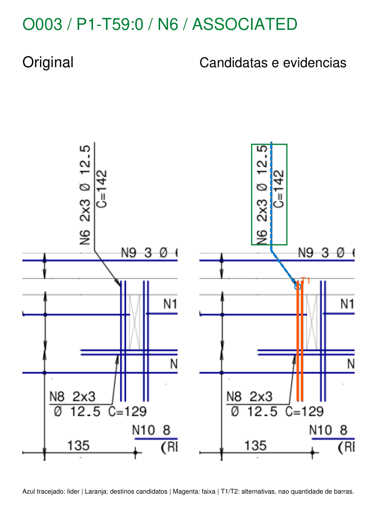
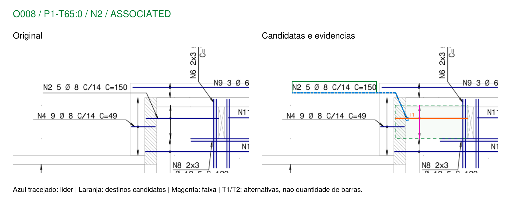

# Etapa 3: linhas de chamada e reforços localizados

Documento: `RMP-EST-LO-1422-LAJ-R00.PDF`, página 1, revisão R00.
SHA-256: `3eae69c055bc2b9e161c7767915f2682f9e7b53651dae073d046ecd0ddb45662`.
Comparação com o inventário da etapa 2, preservado em
`../lajes_geometria_automatico/inventario.json`. Escopo exclusivamente documental.

**Resultado:** o leitor passou de 30 para 50 associações completas experimentais.
As 30 geometrias completas anteriores foram preservadas exatamente. As 20 novas
foram examinadas visualmente pelo assistente e mostraram vínculos gráficos
coerentes com o original. Permanecem 7 ambiguidades e 2 leituras parciais. Nenhuma
dessas contagens é taxa de acerto ou validação independente pelo engenheiro.

## 1. Auditoria antes da implementação

Foram inspecionados `automatic.py`, `geometry.py`, `run_sheet.py`, os testes,
inventários e relatórios anteriores, os segmentos/caminhos brutos e as ampliações
dos casos solicitados. Mantidos os princípios de leitura documental das skills
reinforcement-review e PDF, sem aplicar regras resistentes de vigas às lajes.

| Casos | Causa encontrada na leitura anterior |
|---|---|
| O003/O004 — N6 | Texto vertical; ombro vertical e trecho inclinado até reforço vertical junto à abertura. O algoritmo anterior buscava uma barra sob o texto, sem seguir o líder. |
| O005 — N19 | Líder semelhante ao anterior, mas destino de maior comprimento junto à abertura alongada. Não é a mesma peça N6. |
| O008 — N2 | O ombro horizontal da chamada era candidato fraco a barra. A barra verdadeira está abaixo/à direita e tem faixa própria. |
| O022/O024 — N16 | Texto vertical e cotovelo para pares verticais curtos; há várias linhas horizontais próximas e cruzadas. |
| O039/O040 — N21 | Chamada em duas linhas até traços horizontais curtos. O040 antes capturava como candidata a linha longa N13, com C incompatível. |
| O045/O046 — N5 | Líder até reforço horizontal de borda da abertura. Em O046, o ombro longo havia sido tomado como candidata a barra. |
| O048/O049 — N7 | Líder vertical/inclinado para reforço vertical. O contorno vizinho está muito próximo da ponta e produz outro destino plausível dentro da tolerância. |
| O058 — N36 | Chamada abaixo da barra longa; o ombro é líder. A representação possui faixa convencional, diferentemente dos reforços localizados. |

Reutilizados: inventário/parser, extração vetorial, agrupamento colinear, setas,
marcadores, tabela e renderização. Foram extraídas duas funções pequenas de
`automatic.py`, `bar_axis_intersection` e `graphic_envelope`, para compartilhar a
mesma regra entre o reconhecimento anterior e os destinos encontrados por líder.
Os testes antigos verificam que esse refatoramento preservou o comportamento.

O algoritmo anterior permanece acessível por `read_sheet` e `run_sheet.py`.
`geometry.associate`, a prova N26 e todos os testes anteriores ficaram intactos.
O novo fluxo é `read_sheet_with_leaders` / `run_leaders.py`. Não foram alterados
módulos de vigas, pilares, verificadores ou Concretopy. Resultados das etapas 1 e 2
não foram sobrescritos.

## 2. Rastreamento da trajetória completa

O leitor continua extraindo automaticamente as 59 chamadas de 41 posições. Nesta
folha, as novas trajetórias aceitas têm dois segmentos principais, mas o código
aceita múltiplos segmentos e mudanças de direção, testados sinteticamente.

1. **Ombro candidato:** procurar segmento paralelo e alinhado a uma linha textual
   da chamada. São usadas as caixas das linhas originais, pois a união das caixas
   pode esconder o ombro quando C está impresso do outro lado da linha vertical.
   Alinhamento só inicia a busca; não associa texto à barra por si só.
2. **Conectividade:** construir um grafo de extremidades dos segmentos brutos,
   com tolerância de 0,2 pt. Percorrer cotovelos e ramificações por essas conexões,
   preservando a sequência e os IDs de todos os segmentos.
3. **Cruzamentos:** interseções interiores são registradas, mas não se tornam
   pontos de troca de trajetória. Por exemplo, O003 cruza cinco entidades sem
   seguir suas linhas. Conexões reais entre extremidades podem ramificar a busca.
4. **Terminal:** procurar duas asas de seta orientadas para trás do último trecho,
   ou um pequeno marcador circular no terminal. As setas podem ter qualquer
   orientação. O suporte a marcador circular foi testado sinteticamente; as novas
   associações aceitas desta folha usam setas com duas asas.
5. **Destino:** intersectar a direção do trecho terminal com as linhas candidatas.
   Guardar todas as alternativas, sem escolher a mais próxima. Não se caminha do
   líder para a barra como se ambos fossem a mesma entidade.
6. **Abstenção:** mais de uma rota terminal, mais de um destino, contradição ou
   exploração incompleta bloqueia a aceitação. Um destino reivindicado por outra
   representação também impede aceitar silenciosamente uma nova ocorrência física.

As pontas do PDF nem sempre coincidem com o eixo da linha visada. Foi necessário
admitir uma **interseção limitada da direção terminal**, guardando separadamente
a ponta original e o contato proposto. Limites: até 2 pt ao longo da direção do
último trecho e até 1,5 pt de afastamento da linha candidata. Não são movidos os
segmentos nem a ponta original. Em N36 o afastamento é 1,32 pt; em N2, 0,84 pt.
As imagens e o JSON permitem examinar essa hipótese gráfica.

Outros critérios experimentais: afastamento do ombro em relação à caixa textual
entre -3,5 e 5,5 pt; sobreposição projetada mínima de 65%; até 8 segmentos,
600 pt de percurso e 256 estados por chamada. Não são tolerâncias normativas ou
de obra. Ao atingir um limite, o algoritmo registra o motivo e não aceita a
associação, mesmo que tenha encontrado uma trajetória aparentemente correta.

## 3. Modelo de representação

| Tipo | Evidência usada | Resultado geométrico |
|---|---|---|
| DISTRIBUTED | Barra e eixo com setas/marcador; vínculo textual direto anterior ou líder completo | Linha, eixo e envoltória gráfica. |
| LOCALIZED | Líder completo até linha/conjunto gráfico suficientemente sustentado; sem faixa convencional | Lista de traços e coordenadas; `region_pdf_pt = null`. |
| INCONCLUSIVE | Destinos concorrentes, dados insuficientes ou busca incompleta | Candidatos preservados; sem geometria aceita da ocorrência. |

Para os conjuntos localizados, o leitor associa o traço diretamente visado e
traços paralelos adjacentes de mesma extensão: diferenças dos extremos até 0,3 pt
e separação transversal até 4 pt. Nesta folha, os 15 casos localizados aceitos
possuem pares gráficos próximos. **Dois traços gráficos não são contagem de duas
barras físicas.** A chamada textual continua informando sua própria quantidade.

O campo `localized_scope` limita a interpretação aos traços diretamente visados.
Não se incorporaram automaticamente pares simétricos, bordas opostas ou todos os
pares de uma abertura. `quantity_factors` conserva 2x3/6x3, enquanto
`multiplicity_geometry` permanece `NOT_INFERRED_FROM_PRINTED_FACTORS`.
Assim, aceitar o vínculo N38 com o par indicado não comprova a localização física
dos seis grupos da expressão 6x3. O mesmo limite vale para as chamadas 2x3.

Quando não há espaçamento, ele permanece nulo; isso não impede a representação
localizada. Quando há espaçamento e não se comprova uma faixa, o leitor não converte
automaticamente a peça em localizada para conseguir uma associação completa.

O comprimento C continua nominal. Igualdade entre projeção e C não é condição
geral para peças agrupadas; a concordância é evidência auxiliar. Uma projeção
superior a C em mais de 5% exige revisão segundo o critério experimental anterior.
Nesta execução, as projeções das 20 novas barras visadas são compatíveis com os
C indicados dentro de 1,5%, o que reforça a leitura sem provar dobras/ancoragens.

## 4. Comparação antes/depois

| Situação | Etapa 2 | Etapa 3 |
|---|---:|---:|
| ASSOCIATED | 30 | 50 |
| PARTIAL | 10 | 2 |
| AMBIGUOUS | 8 | 7 |
| UNRESOLVED | 11 | 0 |
| Total de chamadas | 59 | 59 |

As representações atuais são 35 DISTRIBUTED, 15 LOCALIZED e 9 INCONCLUSIVE.
As nove pendências estão integralmente nas classes PARTIAL/AMBIGUOUS.
As 30 associações completas da etapa 2 mantiveram **IDs, evidências e polígonos
exatamente iguais**, incluindo N26/O036. A lista completa e o resultado individual
de preservação constam em [comparacao.json](comparacao.json).

### Ocorrências que mudaram de classificação

| ID | Posição | Antes | Depois | Representação atual |
|---|---|---|---|---|
| O003 | N6 | UNRESOLVED | ASSOCIATED | LOCALIZED |
| O004 | N6 | UNRESOLVED | ASSOCIATED | LOCALIZED |
| O005 | N19 | UNRESOLVED | ASSOCIATED | LOCALIZED |
| O008 | N2 | PARTIAL | ASSOCIATED | DISTRIBUTED |
| O010 | N29 | AMBIGUOUS | ASSOCIATED | DISTRIBUTED |
| O015 | N4 | PARTIAL | ASSOCIATED | DISTRIBUTED |
| O017 | N8 | PARTIAL | ASSOCIATED | LOCALIZED |
| O018 | N4 | PARTIAL | ASSOCIATED | DISTRIBUTED |
| O022 | N16 | UNRESOLVED | ASSOCIATED | LOCALIZED |
| O023 | N8 | PARTIAL | ASSOCIATED | LOCALIZED |
| O024 | N16 | UNRESOLVED | ASSOCIATED | LOCALIZED |
| O025 | N20 | AMBIGUOUS | ASSOCIATED | LOCALIZED |
| O037 | N22 | UNRESOLVED | PARTIAL | INCONCLUSIVE |
| O038 | N22 | PARTIAL | ASSOCIATED | LOCALIZED |
| O039 | N21 | UNRESOLVED | ASSOCIATED | LOCALIZED |
| O040 | N21 | AMBIGUOUS | ASSOCIATED | LOCALIZED |
| O045 | N5 | UNRESOLVED | ASSOCIATED | LOCALIZED |
| O046 | N5 | PARTIAL | ASSOCIATED | LOCALIZED |
| O048 | N7 | UNRESOLVED | AMBIGUOUS | INCONCLUSIVE |
| O049 | N7 | UNRESOLVED | AMBIGUOUS | INCONCLUSIVE |
| O054 | N37 | PARTIAL | ASSOCIATED | LOCALIZED |
| O058 | N36 | PARTIAL | ASSOCIATED | DISTRIBUTED |
| O059 | N38 | UNRESOLVED | ASSOCIATED | LOCALIZED |

São 23 mudanças: 20 novas completas e 3 avanços que mantêm pendências. As outras
36 classificações ficaram iguais. A [tabela de todas as ocorrências](associacoes.md)
inclui links para as ampliações e a situação da conferência visual.

## 5. Conferência visual e vínculos incorretos possíveis

Foram abertas e inspecionadas as 20 novas ampliações completas e os casos pendentes
O037/O048/O049, comparando o original com o percurso e o destino marcados. O registro
está em [conferencia_visual_assistente.json](conferencia_visual_assistente.json),
com IDs dos percursos/destinos aceitos experimentalmente e observações por caso.
O runner rejeita reaplicar uma revisão se esses IDs forem incompatíveis com o
resultado atual. A revisão visual não altera a classificação automática.

Nas 20 novas associações completas, o assistente encontrou coerência entre chamada,
trajetória, ponta e traços selecionados. Não foi observado vínculo completo incorreto
nessa inspeção. Ela **não é validação independente do engenheiro**, não comprova
a totalidade física de cada grupo e não serve para estimar taxa de acerto.

Os falsos candidatos fracos anteriores O008/N2 e O058/N36 eram ombros de líderes;
agora os destinos registrados são as barras efetivamente apontadas. Em O040/N21,
o percurso chega à peça curta, em vez da antiga candidata longa N13.

Há falsos candidatos ou leituras concorrentes que continuam registrados:

- **O048/O049 — N7:** a trajetória chega perto do par vertical correto, mas há
  outra linha de contorno a aproximadamente 1,44 pt da ponta. As duas alternativas
  são preservadas e não existe `leader_association` aceita. Uma preferência visual
  do assistente não promoveu esses casos a ASSOCIATED.
- **O012/O016 — N17 e O037 — N22:** há rota plausível até um par localizado, mas
  também candidatas a ombro coincidentes com linhas de contorno. A exploração
  dessas alternativas atinge limites de comprimento, segmentos e/ou estados.
  A ocorrência permanece ambígua/parcial. É uma limitação concreta do reconhecimento
  de ombros, não evidência de armadura ausente.
- **O009/N18:** há trajetória terminal, sem destino suficientemente resolvido pelos
  limites atuais de contato. Permanece AMBIGUOUS, com o percurso registrado.
- **O014/N33, O028/N23 e O057/N41:** faltam evidências suficientes no modelo atual;
  os estados anteriores PARTIAL/AMBIGUOUS foram mantidos. Não se inventou líder,
  faixa ou polígono para completar essas representações.

Os limiares de contato e de agrupamento podem produzir vínculos errados em outras
pranchas, sobretudo com linhas muito próximas ou pares gráficos não pertencentes
à mesma peça. São hipóteses locais explícitas, não uma regra universal. O uso de
somente extremidades também pode perder líderes divididos em junções em T reais;
o algoritmo não pressupõe conectividade física só porque duas linhas se cruzam.

## 6. Exemplos de evidência

- **N6/O003:** `D1346:0 → D1347:0`, terminal em `(427,080; 440,920)` pt;
  destino `D1638:0` e traço paralelo `D1639:0`. O conjunto é vertical e localizado,
  sem faixa convencional nem envoltória criada.
- **N2/O008:** `D1354:0 → D1355:0`; destino `D1661:0`, com faixa e marcador próprios.
  Os segmentos do líder não integram a barra aceita.
- **N21/O040:** `D1334:0 → D1335:0`; destino `D1616:0` com `D1617:0`, em vez da linha
  longa N13. C indicado 96 cm; projeção da linha visada aproximadamente 95,89 cm.
- **N36/O058:** `D1430:0 → D1431:0`; destino `D1883:0` e faixa própria. A projeção
  da barra é aproximadamente 1.198,67 cm para C=1.200 cm. O pequeno afastamento da
  ponta original está registrado, sem deslocar os vetores de origem.

Todas as coordenadas são pontos PyMuPDF, origem superior esquerda, x para a direita,
y para baixo. Conversões de comprimento usam a escala impressa 1:50 da planta
principal. Não foram obtidas coordenadas globais ou cotas executivas por esse método.

Nas imagens: azul tracejado = líder; laranja = traços dos destinos; magenta = faixa;
caixa do texto = situação da leitura. T1/T2 identificam alternativas, não quantidade
de barras. Um destaque numa ocorrência ambígua/parcial é candidato, sem aceitação.
A [prancha completa anotada](prancha_inventariada.png) localiza os 59 IDs.

## 7. Testes, rastreabilidade e arquivos

**49 testes passaram:** os 28 anteriores, mais 14 sintéticos e 7 regressões reais.
Os novos testes cobrem líder inclinado, múltiplos segmentos/cotovelos, barras
verticais e horizontais, conjunto gráfico sem polígono, cruzamento sem troca,
ausência de ponta, cadeia quebrada, marcador circular, destinos múltiplos,
rota adicional não resolvida, limites de busca, contato terminal limitado,
invariância de cores/ordem e alvo compartilhado entre representações.

As regressões reais conferem os alvos solicitados, N2/N36 com líder distinto da
barra, as alternativas N7, abstenção por limites, cruzamentos N6, invariância da
prancha e preservação exata de todas as 30 associações completas/N26.
Contagens congeladas testam comportamento; não são ground truth independente.

Arquivos principais:

- [Inventário atualizado](inventario.json): entidades associadas, trajetórias,
  terminações, contatos propostos, cruzamentos, grupos, alternativas, estados,
  critérios e proveniência.
- [Comparação por ocorrência](comparacao.json).
- [Tabela Markdown](associacoes.md) e [CSV](associacoes.csv).
- [Extração vetorial bruta](entidades_pagina.json).
- [Prancha completa](prancha_inventariada.png) e 59 ampliações em `ampliacoes/`.
- [Conferência do assistente](conferencia_visual_assistente.json) e
  [modelo para revisão independente](validacao_manual_modelo.json).
- Código: `tools/slab_geometry_poc/leaders.py`, `run_leaders.py` e testes novos.
  Reprodução no README do módulo.

O inventário registra hash do PDF, hash do inventário anterior, versão do motor
e hashes dos arquivos de implementação. O PDF original foi apenas lido e manteve
o SHA-256. Não foi criado/salvo um PDF marcado; as marcações estão somente nos PNGs.

## 8. Recomendação técnica

O avanço é sustentado por trajetórias explícitas e conferência visual, com
abstenção em destinos concorrentes. O próximo passo deve priorizar distinguir
ombros de chamada de contornos próximos e validar a semântica de grupos localizados
com João. Não convém simplesmente aumentar limites de exploração ou tolerâncias
de contato para transformar as nove pendências em completas.

É necessária uma referência independente que inclua acertos, vínculos incorretos,
grupos parciais e textos eventualmente omitidos. Só então calcular cobertura e
avaliar falsos vínculos, com pranchas de outros escritórios fora da calibração.
Os campos `coverage`, `accuracy` e validações independentes permanecem sem resultado
ou zero nesta execução. Nenhuma região ou conjunto produzido está liberado para
flexão, ancoragem, dimensionamento, otimização ou ATP resistente.
