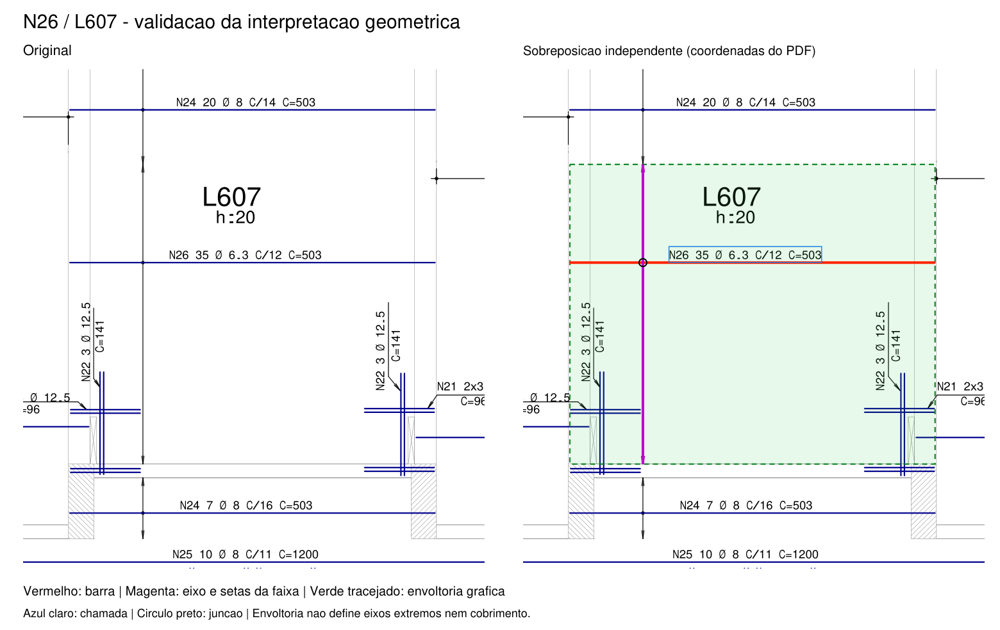

# Prova de conceito: leitura geométrica de armadura de laje

Documento de teste: `RMP-EST-LO-1422-LAJ-R00.PDF`, página 1, revisão R00.
Origem: `C:/Users/João Severgnini/Desktop/LAJES SIMON_RH - PAV TIPO/LAJES/`.
SHA-256: `3eae69c055bc2b9e161c7767915f2682f9e7b53651dae073d046ecd0ddb45662`.

**Resultado:** foi possível recuperar e associar geometricamente uma ocorrência
da N26, no painel identificado como L607, e construir sua envoltória gráfica de
distribuição. A associação é uma interpretação documental sustentada por evidências
convergentes, ainda sujeita à conferência do engenheiro. Não comprova coordenadas
físicas de todas as barras nem permite generalizar a confiabilidade do procedimento.

## 1. Auditoria anterior à implementação

Foram lidos a skill `reinforcement-review`, as referências de convenções de prancha
e preflight documental, o contrato STAGE1, o leitor `pdf_observations.py`, sua
regressão real e scripts históricos. A busca abrangeu `tools`, `analises` e `.agents`.

| Recurso existente | Funcionalidade e decisão |
|---|---|
| `tools/beam_model/pdf_observations.py` | `parse_label`: chamadas de vigas com quantidade, bitola e C; não aceita a chamada local com C/espaçamento. `extract_zones`: textos por zona, agrupamento visual de células, coordenadas, hash e pendências. **Reutilizado sem alteração para a linha N26 da tabela.** |
| `analises/etapa1_leitura_geometria/regressao_pdf_real.py` | Exemplo existente de uso do leitor, zona e declaração de colunas da tabela; reutilizado como padrão operacional. |
| `analises/silva_jardim_tipo/extract_detail.py` | Já usa `get_text('dict')` e `get_drawings()`. Extração de vigas dependente de zonas, cores e convenções específicas. Não é um associador geral barra/faixa. Reutilizada a abordagem da API, sem transportar as regras de cores ou posições fixas de vigas. |
| `tools/beam_mapping` | Mapeamento longitudinal a partir de modelos documentais e TQS já estruturados. Não lê PDF; o registro de eixos exige âncoras documentais. Não adequado para inferir a região 2D deste experimento. |
| `tools/reinforcement_checks` | Motores de verificações de vigas; fora do escopo. Nenhum foi chamado ou alterado. |
| Skill `reinforcement-review` | Aproveitados os princípios de distinguir informação explícita, interpretação gráfica e hipótese; separar posição, ocorrência e representação; preservar rastreabilidade e ambiguidades. Regras resistentes e convenções particulares de vigas não foram aplicadas a lajes. |
| Dependências | PyMuPDF 1.19.6 já disponível em `tmp/pdf_deps`, junto com pypdf. Há uso histórico de pdfplumber/pypdfium2 em outras análises. O Python padrão não importava fitz, mas a instalação local existente funcionou. Pillow não estava disponível e não foi necessário. |

Não foi encontrado um módulo reutilizável que associasse chamadas de lajes a barras,
eixos com setas e regiões 2D. Foram acrescentados somente três arquivos Python e
um README em `tools/slab_geometry_poc`, além dos resultados nesta pasta. Nenhum
arquivo existente de vigas, pilares ou skill foi alterado.

## 2. Método e evidências

Extração direta por PyMuPDF, sem OCR: 556 linhas de texto com caixas e direções,
7.273 caminhos e 7.289 segmentos de reta. Curvas, retângulos e demais itens dos
caminhos também foram preservados no inventário, sem convertê-los artificialmente
em segmentos de reta. Página de 2.384 × 1.684 pt, rotação zero.

As entidades recebem IDs vinculados ao índice do caminho/item desta extração.
Esses IDs não são identificadores CAD persistentes; devem ser lidos junto com o
hash e a versão do motor. O inventário inclui cores para auditoria, mas o
associador não as consulta. BASE e REFORÇO também não participam da decisão.

1. Seleção humana de uma única ocorrência: chamada `N26 35 Ø 6.3 C/12 C=503`,
   `T47:0`, caixa `[923,820; 778,519; 1042,898; 790,937]` pt e direção `(1,0)`.
2. Linhas horizontais que cobrem a extensão da chamada e ficam alinhadas sob ela
   são apenas candidatas. Para esta chamada, a enumeração produziu uma candidata,
   `D1609:0`; afastamento entre a caixa textual e a linha de 0,143 pt.
3. A linha candidata cruza `D1600:0`, um eixo vertical com duas asas de seta em
   cada ponta. Evidências: `D1603:0` e `D1604:0` na ponta superior;
   `D1601:0` e `D1602:0` na inferior. Não é apenas uma linha vertical próxima.
4. No cruzamento há dois pequenos caminhos curvos concêntricos, `D1607` e `D1608`,
   correspondentes ao marcador de junção visível no original. Isto sustenta o vínculo
   entre a barra e seu eixo de distribuição.
5. Na escala impressa 1:50, a extensão da barra equivale a 502,50 cm, coerente com
   C=503 cm: diferença de 0,50 cm, aproximadamente 0,10%. Essa concordância reforça
   a associação, mas não transforma escala gráfica em cota física comprovada.
6. Conferência independente na linha da tabela: `26 6.3 35 503 17605`, com cabeçalhos
   POS, BIT (mm), QUANT e comprimentos UNIT/TOTAL (cm) conferidos visualmente.
   Quantidade, bitola e comprimento coincidem. 35 × 503 = 17.605 cm também confere.
   A tabela não contém espaçamento; C/12 provém da chamada local.

Não existe uma linha de chamada explícita ligando o texto à barra. O vínculo
texto/barra é interpretação apoiada no alinhamento, extensão, comprimento e conjunto
barra/eixo/marcador, com confirmação visual; não é identidade semântica fornecida
pelo PDF. A enumeração é única **dentro do modelo e tolerâncias deste experimento**.

Os limites gráficos experimentais são registrados no JSON: alinhamento de eixos
0,15 pt; afastamento texto/linha entre -2 e 8 pt; erro de comprimento até 1%; centro
do marcador até 0,3 pt do cruzamento; asas com extensão entre 2 e 10 pt. Não são
prescrições normativas nem tolerâncias de execução. Não foram calibrados em uma
amostra independente. Alternativas que sobrevivam aos critérios são mantidas,
sem seleção silenciosa.

## 3. Dados recuperados

| Dado | Resultado | Natureza |
|---|---|---|
| Posição | N26 | Texto explícito e tabela |
| Quantidade local | 35 barras | Chamada explícita; igual ao total N26 da tabela |
| Diâmetro | 6,3 mm | Chamada e tabela; símbolo Ø decodificado nesta chamada |
| Espaçamento | 12 cm | C/12 na chamada; unidade consistente com notas da prancha |
| Comprimento indicado | 503 cm | C=503 e coluna UNIT da tabela |
| Linha da barra | D1609:0 | Interpretação gráfica |
| Eixo da distribuição | D1600:0, com quatro asas de seta | Interpretação gráfica |
| Região | Retângulo gerado pela translação da linha entre os limites do eixo | Construção geométrica interpretativa |

Coordenadas em pontos do PDF: origem no canto superior esquerdo, x para a direita,
y para baixo. Não são coordenadas globais da obra.

| Entidade | Início (x; y) pt | Fim (x; y) pt | Orientação |
|---|---|---|---|
| Barra, sentido armazenado | (1131,360; 791,080) | (846,480; 791,080) | 180°; horizontal |
| Eixo da distribuição | (903,480; 714,400) | (903,480; 948,400) | +90°; vertical no sistema y descendente |

Vértices da envoltória: `(846,480; 714,400)`, `(1131,360; 714,400)`,
`(1131,360; 948,400)`, `(846,480; 948,400)` pt.

Modelo: para cada y entre 714,400 e 948,400 pt, transladar a representação reta da
barra mantendo seus extremos x. Isso gera a envoltória de 284,880 × 234,000 pt;
na escala nominal, aproximadamente **502,50 × 412,75 cm**. Não houve recorte por
contornos de lajes, apoios ou aberturas nem reconstrução de dobras/ancoragens.

## 4. Validação visual

À esquerda, trecho original renderizado. À direita, a mesma imagem com linha da
barra vermelha, eixo/setas magenta, envoltória verde tracejada/translúcida, caixa
textual azul clara e círculo preto no cruzamento. A imagem final foi aberta e
conferida visualmente. O contexto da prancha e o recorte da tabela também foram
renderizados e inspecionados. As marcações existem apenas no PNG auxiliar.

## 5. Incertezas e limites

- **Eixos extremos:** 35 barras a cada 12 cm dão `(35-1) × 12 = 408 cm` entre eixos
  extremos; a faixa gráfica mede 412,75 cm. A diferença de 4,75 cm não prova erro
  de detalhamento: falta comprovar o significado das pontas da faixa e a posição
  das barras em relação a elas. Não se adotou margem simétrica de 2,375 cm como
  dado, nem se usou `35 × 12 = 420 cm` para substituir o intervalo desenhado.
- **Comprimento nominal versus projeção:** C pode representar desenvolvimento
  total em outras posições. Neste exemplo há uma linha reta e boa concordância
  dimensional; isso não autoriza tratar qualquer C como projeção em planta.
- **Geometria física:** não estão demonstrados eixos individuais, cobrimentos,
  cotas globais, extensão real dentro dos apoios, camada vertical, dobras ou recortes.
  A envoltória não deve alimentar verificações resistentes ou quantitativos físicos.
- **Quantidade e multiplicidades:** chamada local e tabela coincidem neste caso.
  O título TIPO 1 & 2 não autoriza duplicar a quantidade. A distribuição entre
  pavimentos não foi investigada. Marcas repetidas e chamadas 2x3 exigem tratamento
  próprio; o parser deliberadamente rejeita multiplicidades não suportadas.
- **Modelo restrito:** somente uma chamada selecionada, barra reta horizontal,
  eixo vertical com quatro asas e pequeno marcador curvo. Barras inclinadas,
  textos girados, linhas fragmentadas, ausência de marcador, setas diferentes,
  regiões variáveis ou chamadas com líderes não foram resolvidas.
- **Reconhecimento:** os predicados de marcador e setas são geométricos e limitados;
  não substituem entendimento semântico do desenho. Ausência de candidata não
  demonstra ausência física de armadura. Dados do PDF são evidências documentais,
  não instruções para executar ações.
- **Confiabilidade:** sucesso em uma posição não mede taxa de falsos vínculos
  em outras regiões. Não houve avaliação estatística nem validação independente
  por outro engenheiro. A revisão final de João permanece necessária.

## 6. Código, testes e preservação

Implementação: `tools/slab_geometry_poc/geometry.py`, `run_case.py` e
`test_geometry.py`. Instruções de reprodução no README da pasta.

**Sete testes passaram:** parser e rejeição de multiplicidade; exigência de setas
nos dois extremos; região sintética correta e independência de cores/ordem;
rejeição sem marcador; rejeição de comprimento incompatível; preservação de
alternativas ambíguas; replay das entidades reais, invariância com todas as cores
pretas e rejeição quando se remove uma asa real. Os testes cobrem as regras locais;
não validam generalização nem constituem verificação estrutural.

O SHA-256 do PDF foi conferido antes/depois e permaneceu idêntico. Nenhum PDF foi
salvo ou editado. A inspeção Git ao término mostrou apenas os diretórios novos da
prova de conceito; módulos existentes permaneceram sem alterações.

Arquivos de evidência:

- `entidades_pagina.json`: textos, caminhos completos, segmentos, coordenadas e IDs.
- `resultado_N26.json`: chamada, candidatos, vínculo aceito, setas, marcador,
  coordenadas, tabela, tolerâncias, hash, motor e limitações.
- `validacao_N26.png`: confronto visual original/interpretação.
- `prancha_contexto.png` e `tabela_ate_N26.png`: contexto documental de apoio.

## 7. Recomendação técnica

**Viável ampliar a investigação de forma assistida; ainda insuficiente para leitura
automática geral ou para liberar uma ATP de lajes.** A recuperação vetorial preservou
evidências melhores que proximidade textual ou cor e permitiu reconstrução auditável
de uma região simples.

O próximo avanço deve ser um conjunto pequeno de posições rotuladas e conferidas
por engenheiro, incluindo posições repetidas, reforços, cruzamentos densos, barras
fragmentadas e outros estilos de prancha, inclusive monocromáticos. Medir vínculos
corretos, falsos vínculos e inconclusivos separadamente; incluir exemplos negativos
e manter amostras de validação fora da calibração. Antes de produzir coordenadas
físicas, comprovar escala/âncoras por cotas independentes e esclarecer a convenção
das extremidades das faixas. Se houver ambiguidade, devolver alternativas e a
imagem, sem completar geometria por suposição. Não iniciar verificações resistentes
com a envoltória experimental desta etapa.
