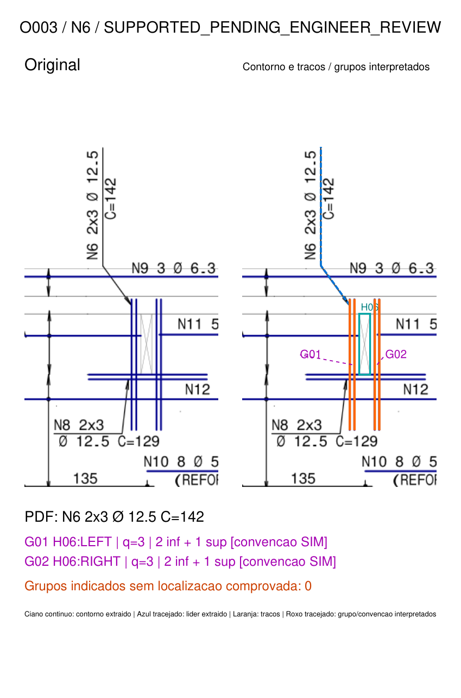
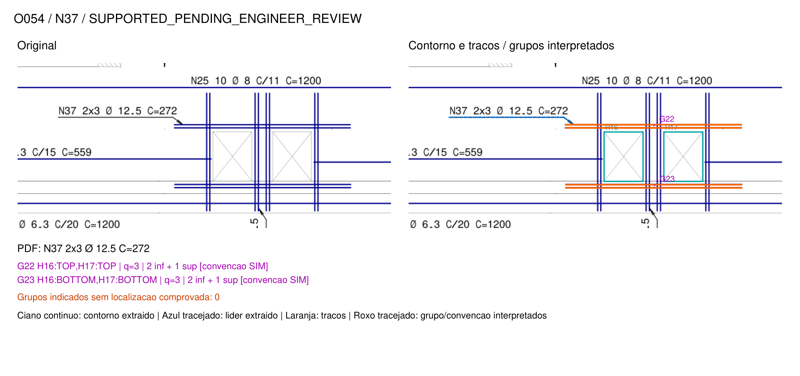

# Etapa 4: conjuntos físicos de armaduras localizadas

Documento: `RMP-EST-LO-1422-LAJ-R00.PDF`, página 1, R00.
SHA-256: `3eae69c055bc2b9e161c7767915f2682f9e7b53651dae073d046ecd0ddb45662`.
Entrada documental: inventário da Etapa 3, preservado. Convenção: confirmação
explícita de João nesta solicitação, vinculada ao detalhe de furos da SIM e a este PDF.

**Resultado:** as 15 representações LOCALIZED foram organizadas em **23 hipóteses
de grupos físicos**, com traços, orientação, localização e vínculos às aberturas.
Foram reconhecidas geometricamente 12 possíveis aberturas entre 17 candidatas
retangulares com diagonais. A reconstrução de 13 chamadas não apresenta pendência
de localização dentro dos critérios locais; N8/O023 e N38/O059 continuam parciais.
As 35 representações DISTRIBUTED e todos os registros da Etapa 3 ficaram idênticos.

Os grupos são interpretações do layout desenhado, pendentes de validação independente
do engenheiro. O título TIPO 1 & 2 não foi usado para multiplicar grupos por pavimento.
Nenhum resultado foi utilizado em verificação resistente ou julgamento de conformidade.

## 1. Auditoria e reaproveitamento

Antes da implementação foram consultados código, inventários, relatório e ampliações
anteriores. As 15 LOCALIZED já continham chamada, fatores, quantidade total,
diâmetro, C nominal, trajetória completa do líder e dois traços diretamente visados.
Não continham identificação de abertura, atribuição à borda oposta, número de
barras por grupo ou distribuição na espessura da laje.

O detalhe geral de furos foi renderizado e examinado, com planta e CORTE A-A.
Ele mostra o símbolo retangular com diagonais e a representação dos reforços nas
bordas. O significado numérico **2 inferiores + 1 superior** foi fornecido
explicitamente por João; não foi tratado como texto numérico extraído do PDF.

Reutilizadas `geometry.extract_page`, `automatic.line_geometry`, as chamadas,
trajetórias e associações de `leaders.py`, e os recursos de renderização existentes.
O novo módulo `opening_groups.py` apenas enriquece uma cópia do resultado anterior.
Não altera os classificadores anteriores, os motores de vigas/pilares ou Concretopy.

Foram adicionados `opening_groups.py`, `run_opening_groups.py`, dois arquivos de
testes e o perfil documental `conventions/sim_opening_edge_v1.json`. O runner
reextrai o PDF e verifica igualdade das entidades com a extração da Etapa 3 antes
de usar seus IDs. Registra hashes do PDF, inventário anterior, perfil e código.

## 2. Informações extraídas diretamente

São dados documentais, preservados sem alteração:

- Marca, texto, fatores 2x3/6x3, quantidade total indicada, diâmetro e C nominal.
- Coordenadas e IDs dos segmentos de contorno, diagonais, reforços e líderes.
- Título e localização do detalhe: página 1, caixa `[1440;1250;1720;1620]` pt;
  textos T192:0, T188:0 e T187:0: detalhe geral, furos das lajes e corte A-A.

C continua sendo comprimento nominal da chamada, sem reconstrução de dobras ou
ancoragens. Coordenadas em pontos PyMuPDF, origem superior esquerda, x à direita e
y para baixo. As dimensões convertidas usam a escala impressa 1:50, permanecendo
**dimensões gráficas estimadas**, não cotas físicas comprovadas.

## 3. Reconhecimento geométrico das aberturas

O detector propõe contornos a partir de duas diagonais com a mesma caixa e sentidos
opostos. Confere cobertura dos quatro lados por segmentos vetoriais. Depois exige
pares de reforços junto a pelo menos dois lados. Essa combinação reduz a confusão
com painéis, contornos estruturais e símbolos auxiliares. Cor não participa da decisão.

Retângulo isolado ou retângulo com X sem contexto de reforços fica sem confirmação.
Os IDs H01–H05 permaneceram `UNCONFIRMED_RECTANGLE_X`; não são contabilizados como
aberturas apoiadas geometricamente. H06–H17 receberam
`GRAPHICALLY_SUPPORTED_OPENING`, ainda sujeitos à revisão do engenheiro.

| ID provisório | Caixa (x0; y0; x1; y1), pt | Dimensões gráficas aproximadas, cm |
|---|---|---|
| H06 | 432,84; 446,08; 439,56; 483,40 | 11,85 × 65,83 |
| H07 | 1538,16; 446,08; 1545,00; 484,60 | 12,07 × 67,94 |
| H08 | 608,52; 464,80; 616,92; 473,32 | 14,82 × 15,03 |
| H09 | 692,76; 464,80; 712,56; 555,40 | 34,92 × 159,81 |
| H10 | 1360,92; 464,80; 1369,44; 473,32 | 15,03 × 15,03 |
| H11 | 862,32; 555,40; 1115,40; 569,56 | 446,41 × 24,98 |
| H12 | 862,32; 911,56; 867,36; 948,40 | 8,89 × 64,98 |
| H13 | 1110,36; 911,56; 1115,40; 948,40 | 8,89 × 64,98 |
| H14 | 394,80; 944,44; 408,96; 967,12 | 24,98 × 40,00 |
| H15 | 1568,76; 944,44; 1582,92; 967,12 | 24,98 × 40,00 |
| H16 | 945,96; 1063,84; 979,92; 1106,92 | 59,90 × 75,99 |
| H17 | 998,04; 1063,84; 1032,00; 1106,92 | 59,90 × 75,99 |

O arquivo `aberturas.json` conserva os quatro vértices, diagonais, IDs dos segmentos
que cobrem cada lado e os pares que sustentam o contexto de borda. O reconhecimento
não constitui levantamento completo de todos os furos: outras formas/símbolos não
estão cobertos por esse detector. H11 é reconhecida no mapa, mas não recebeu grupos
de uma chamada fora das 15 LOCALIZED aceitas da etapa anterior.

## 4. Associação às bordas e reconstrução de grupos

A associação exige orientação paralela à borda, traços posicionados fora do contorno
e prolongamento longitudinal além das duas extremidades da borda. O leitor enumera
todas as relações que satisfazem os critérios, sem escolher a abertura mais próxima.
Mais de uma relação incompatível permanece ambígua, com alternativas armazenadas.

Critérios experimentais em pontos PDF: afastamento normal da borda entre 0,4 e 8 pt;
prolongamento mínimo de 2 pt em cada ponta; traços adjacentes separados de 1 a 4 pt;
extremos do par coincidentes dentro de 0,3 pt. Para o grupo da borda oposta,
admite-se até 1 pt de deslocamento dos extremos longitudinais em relação ao alvo.
São tolerâncias de reconhecimento gráfico, sem caráter normativo ou executivo.

Para uma chamada 2x3, um segundo grupo só é aceito quando existe um par gráfico
na borda oposta, de orientação/extensão compatíveis, sem concorrente documental,
e a convenção SIM está confirmada para este documento. Ele é fundamentado pelos
vetores existentes e pela convenção, não criado para fechar a quantidade seis.

As identidades ficam separadas:

| Identidade | Exemplo e significado |
|---|---|
| Posição documental | N6; pode ocorrer em regiões distintas. |
| Representação textual | O003 / P1-T59:0; chamada com seu líder. |
| Grupo físico interpretado | G01 / ID estável G-…; barras na borda esquerda de H06. |
| Traço gráfico | D1638:0 e D1639:0; dois vetores ligados ao mesmo grupo. |

O ID do grupo usa posição e geometria, com coordenadas arredondadas a 0,01 pt
para identidade. Chamadas repetidas no mesmo local reutilizam o grupo e acrescentam
suas referências. Chamadas N6 em aberturas diferentes geram grupos distintos porque
suas geometrias são diferentes. Não se deduplica pelo número da marca apenas.

Um grupo contínuo pode atender várias aberturas alinhadas. Para N37/O054, G22 e
G23 passam respectivamente acima e abaixo de H16 e H17: existem **dois grupos**
contínuos, com dois vínculos de borda cada um, sem duplicação por abertura.

TOP/BOTTOM indicam posição **em planta** no sistema y descendente. Não significam
camada superior/inferior na espessura da laje. A camada vem da fonte descrita a seguir.

## 5. Informações provenientes da convenção SIM

Perfil: [sim_opening_edge_v1.json](../../tools/slab_geometry_poc/conventions/sim_opening_edge_v1.json).
Ele registra escritório, hash específico do PDF, confirmação do engenheiro,
referência à solicitação e caixa/textos do detalhe construtivo consultado.

Para reforços comprovadamente ligados à borda de furo, são aplicados:

- **2x3:** dois grupos indicados, um em cada lado; três barras por grupo.
- **3 sem multiplicidade:** quantidade três vem diretamente da chamada do grupo
  visado. O detalhe confirmado fundamenta sua distribuição vertical.
- **Distribuição vertical aplicável:** duas barras inferiores e uma superior por
  grupo, com origem `OFFICE_CONVENTION_NOT_PLAN_GEOMETRY`.

Essas informações foram aplicadas a 22 grupos em 14 representações. Entre elas
está o grupo realmente localizado de O023: ele recebe os dados por grupo da
convenção, enquanto a localização do segundo grupo continua pendente. Não foi
desenhado esse segundo grupo ausente da interpretação.

Sem perfil explícito, fonte confirmada, correspondência de escritório/documento
ou associação suficiente à borda, as camadas permanecem desconhecidas. A regra
não é normativa nem automaticamente transferível a outro projeto SIM ou escritório.
O perfil exclui 6x3. Alterações incompatíveis nos valores da regra bloqueiam sua
aplicação e pedem revisão.

Há suporte para `specific_overrides` por representação, com fonte de detalhe
específico. Uma divergência bloqueia a aplicação da convenção e a atribuição do
grupo oposto baseada nela; guarda proposta da convenção e evidência conflitante,
marcando `CONFLICTING_REQUIRES_ENGINEER_REVIEW`. Esse mecanismo foi testado
sinteticamente; não é um leitor automático da semântica de todo detalhe específico.
Não foi identificado nesta execução um detalhe específico com distribuição numérica
contrária à confirmação de João.

## 6. Resultado por chamada e multiplicidades

| Representação | Posição | Abertura(s) | Grupos localizados | Situação da reconstrução |
|---|---|---|---|---|
| O003 | N6 2x3 | H06 | G01, G02 | Dois lados sustentados. |
| O004 | N6 2x3 | H07 | G04, G03 | Dois lados sustentados. |
| O005 | N19 2x3 | H09 | G07, G06 | Dois lados sustentados. |
| O017 | N8 3 | H07 | G10 | Grupo singular inferior em planta. |
| O022 | N16 3 | H10 | G08 | Grupo singular à esquerda. |
| O023 | N8 2x3 | H06 | G09 | **Parcial: um grupo indicado sem localização comprovada.** |
| O024 | N16 3 | H08 | G05 | Grupo singular à direita. |
| O025 | N20 3 | H09 | G11 | Grupo singular inferior em planta. |
| O038 | N22 3 | H13 | G12 | Grupo singular à esquerda. |
| O039 | N21 2x3 | H13 | G13, G17 | Dois lados sustentados. |
| O040 | N21 2x3 | H12 | G14, G18 | Dois lados sustentados. |
| O045 | N5 2x3 | H15 | G16, G20 | Dois lados sustentados. |
| O046 | N5 2x3 | H14 | G19, G15 | Dois lados sustentados. |
| O054 | N37 2x3 | H16 e H17 | G22, G23 | Dois grupos contínuos compartilhados pelas aberturas. |
| O059 | N38 6x3 | H16 | G21 | **Parcial: significado físico dos fatores não confirmado.** |

Cada grupo possui posição, referências das chamadas, localização PDF, bordas,
orientação, traços, diâmetro, C nominal, quantidade por grupo quando fundamentada,
distribuição vertical e respectivas fontes/estados de validação.

**N8/O023:** total indicado seis, fatores `[2,3]`, dois grupos indicados pela
convenção, um localizado e um com localização desconhecida. Não foi comprovado
o grupo na borda oposta pelos critérios atuais. Isso não demonstra que a armadura
esteja fisicamente ausente ou que a prancha esteja incorreta.

**N38/O059:** total indicado dezoito, fatores `[6,3]`, apenas o grupo diretamente
visado aceito como localização G21. Quantidade por grupo, número de grupos
indicados fisicamente, número de grupos sem localização e camadas permanecem
desconhecidos. Há outros pares visíveis na região, mas não foram atribuídos à N38
sem comprovar sua função. O JSON conserva o cenário condicional de cinco locais
faltantes **somente se** o primeiro fator seis significar grupos; isso não é
conclusão nem cria cinco grupos. A convenção 2+1 não foi aplicada.

## 7. Validação visual e rastreabilidade

Foram abertas as 15 ampliações, o mapa das candidatas e o detalhe SIM. O registro
da inspeção do assistente está em
[conferencia_visual_assistente.json](conferencia_visual_assistente.json).
Os vetores e relações mostrados são visualmente coerentes nas imagens examinadas,
com as pendências O023/O059 preservadas. A distribuição na espessura não é verificável
pela planta; sua fonte é a confirmação do engenheiro e o detalhe construtivo.

Nas ampliações, o original fica à esquerda. Ciano contínuo: contorno extraído;
azul tracejado: líder extraído; laranja: traços do reforço; roxo tracejado/rótulos:
grupo e dados interpretados da convenção. As imagens não desenham barras fictícias
para materializar as quantidades. Os estados de validação dos grupos e das aberturas
continuam pendentes da revisão independente por João.

## 8. Testes e preservação das etapas anteriores

**69 testes aprovados:** 49 anteriores preservados e 20 novos (14 sintéticos,
6 regressões reais). Foram cobertos reconhecimento de abertura retangular,
rejeição de retângulo/X sem reforços, grupos horizontais/verticais em lados opostos,
uma chamada com vários grupos, deduplicação de chamadas repetidas, 2x3/6x3,
ausência de convenção aplicável, conflito de detalhe, relação ambígua entre abertura
e reforço e preservação de grupos não resolvidos.

As regressões reais verificam as 12 aberturas/23 grupos como snapshot de comportamento,
as localizações distintas das N6, as pendências N8/N38, N37 sem duplicação por furo,
invariância de cores/ordem e igualdade integral das 59 representações da Etapa 3.
**As 35 DISTRIBUTED, incluindo N26, permanecem exatamente iguais.**
Os estados 50 ASSOCIATED / 2 PARTIAL / 7 AMBIGUOUS da leitura da Etapa 3 também
permaneceram iguais; a reconstrução física tem estado próprio, sem promover ou
rebaixar retroativamente a leitura textual/gráfica anterior.

O PDF original e o inventário da Etapa 3 mantiveram seus hashes. O novo processo
não salva ou edita PDF. Não houve alteração em vigas, pilares ou Concretopy.

## 9. Arquivos e próximas revisões

- [Inventário completo enriquecido](inventario.json).
- [Candidatas e aberturas com evidências](aberturas.json) e [mapa](aberturas.png).
- [Grupos físicos estruturados](grupos_fisicos.json) e [CSV](grupos.csv).
- [Representações localizadas e multiplicidades](reforcos_localizados.json).
- [Tabela com links para as 15 ampliações](associacoes.md).
- [Detalhe SIM consultado](detalhe_furos_SIM.png).
- Código e reprodução: `tools/slab_geometry_poc/README.md`.

Prioridades para revisão de João: confirmar a localização do segundo grupo N8/O023,
esclarecer o significado e os locais de 6x3 na N38/O059 e conferir a aplicação do
detalhe aos grupos contínuos da N37. As outras representações ainda inconclusivas
na Etapa 3, como N7/N17, não foram promovidas por este enriquecimento.

A leitura é limitada a contornos ortogonais com X e ao perfil documental desta
prancha. Não identifica automaticamente toda abertura de qualquer formato nem
comprova todos os reforços de cada furo. Zero grupos sem localização numa chamada
significa apenas consistência daquela representação com o perfil aplicado.
As tolerâncias não foram calibradas em amostra independente, e a identidade por
geometria não resolve repetições entre pavimentos. Cobertura física e taxa de acerto
continuam sem cálculo. Os grupos organizados permitem revisão rastreável sem
completar a geometria por aritmética ou liberar qualquer verificação resistente.
