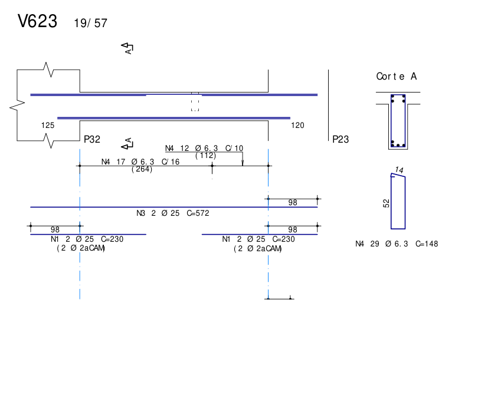
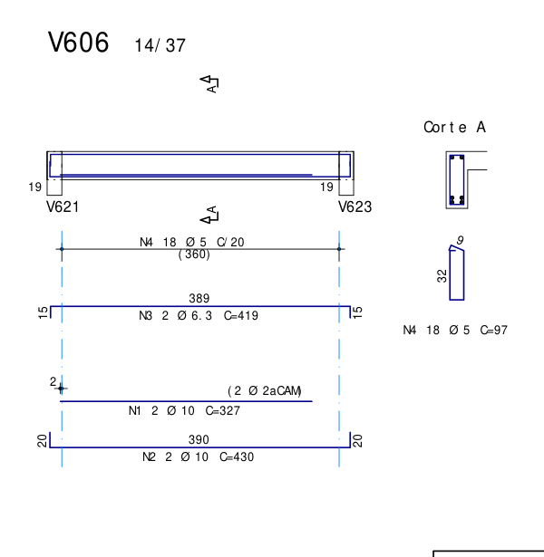
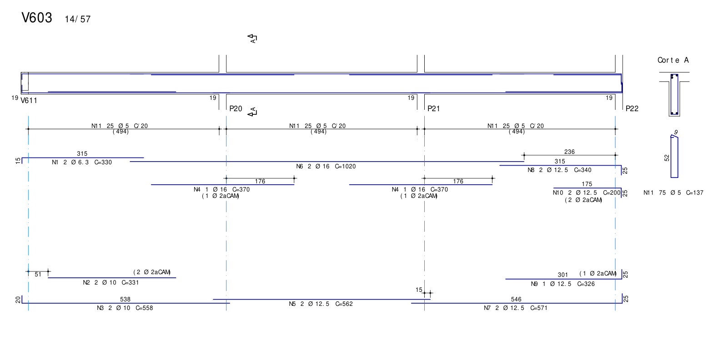
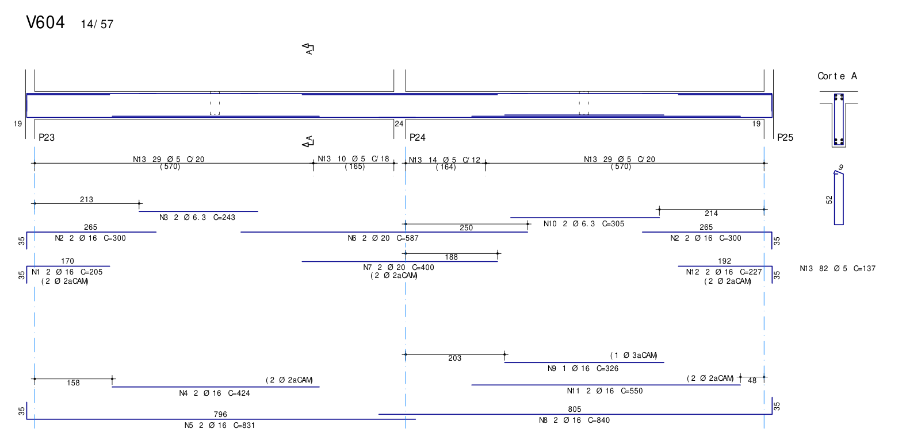
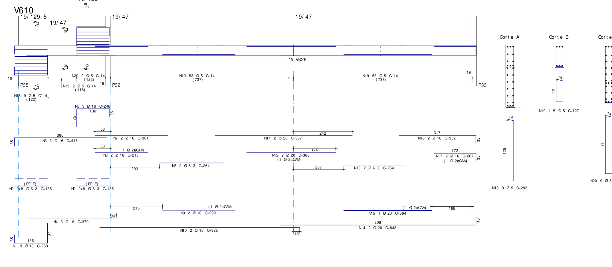
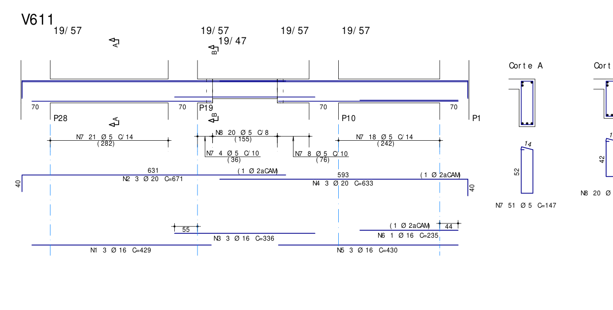
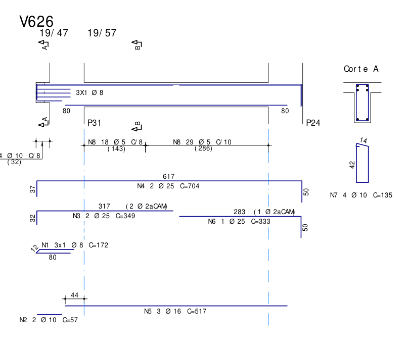

# Revisão de armaduras — Silva Jardim — TIPO

OS 24-212 • 08/10/2026 • V601 a V629 • Revisão do desenho existente, sem propostas de alteração.

## Conclusão

As seções nominais da forma e dos detalhes são compatíveis nas 29 vigas identificadas. Foram encontrados resultados desfavoráveis em flexão, cortes positivos, ancoragem, cortante e suspensão. A V610, as transições da V611 e o nó da V626 exigem interpretação geométrica específica. Não é possível declarar o conjunto aprovado. Os resultados conservadores e próximos ao limite estão separados das falhas documentais e das pendências físicas.

| Ponto principal | Resultado e alcance |
|---|---|
| V623: identificação da positiva | N2 consta na relação de aço: 4 Ø16, C=464 cm. Não está identificada/cotada na elevação; o corte A representa quatro barras inferiores. Resistência e ancoragens positivas não demonstradas. |
| V606: momento e estribos | Msk negativo=9,16 kN.m; duas Ø6,3 superiores equivalem a 6,44 kN.m no ensaio. Estribos a 20 cm versus smax=19,20 cm. A suspensão recebida pela V623 também apresenta déficit no cenário adotado. |
| Cortante V602/V604/V627/V629 | Há faixas com Asw/s entre aproximadamente 2% e 4% abaixo da exigida. Não se trata apenas do arredondamento da taxa mínima. |
| Cortes V603/V604 | N2 Ø10 da V603 e N4 Ø16 da V604 falham em al+10φ. A flexão regional, sozinha, não identifica essa questão. |
| Dobras negativas e nós | Numerosas pernas verticais ficam abaixo do critério do escritório. Centros transversais, vibrador, armaduras dos pilares, pinos e confinamento não estão completamente demonstrados. |
| Suspensão | Resultados desfavoráveis na V623 recebendo V606 e V604 recebendo V624/V628, condicionados às premissas de reação e ao procedimento do escritório. |

## Fontes e hipóteses

PDFs, todos com uma página: 051-SJ-EST-EX-010-PLB-TP-R01.pdf (forma); 051-SJ-EST-LO-06301-VIG-TIP-R00.PDF (V601–V607); 06302 (V608–V620); 06303 (V621–V629). Pasta: S:\PROJETOS EM EXECUÇÃO\24-212-TGD-SILVA JARDIM-POA-RS\APOIO\JOÃO\TIPO.

Resultados locais: C:\TQS\TGD - SILVA JARDIM\24-212-TGD-SILVA JARDIM-R35\TIPO\VIGAS. Foram usados os LST e seus registros de origem. VGESFS identifica esforços de grelha/pórtico espacial e está datado de 08/10/26. A equivalência formal entre forma R01, detalhes R00 e modelo R35 não foi demonstrada; as fontes e revisões são mantidas separadas.

fck=40 MPa; longitudinais CA50/fyk500 MPa; estribos Ø5 listados como 60B e Ø6,3 como 50A. γf=γc=1,4 dos TQS; γs=1,15 adotado. Cobrimento=2,5 cm. No cortante, fyk real foi usado na taxa mínima e fywd foi limitado conservadoramente a 434,78 MPa para ambas as classes. O adaptador restringe o parâmetro do material; as equações resistentes permanecem no Concretopy.

A edição registrada no TQS é ABNT NBR 6118:2023. O texto integral da norma não foi consultado. As conclusões decorrem dos ensaios Concretopy e dos procedimentos da skill reinforcement-review; não são certificação normativa integral. O limite conservador de tensão transversal foi confrontado com pesquisa institucional UFAL que adota 435 MPa para CA50/CA60; essa fonte não substitui a norma.

[Fonte institucional UFAL — tensão transversal](<https://www.repositorio.ufal.br/bitstream/123456789/15214/1/OTIMIZA%C3%87%C3%83O%20DE%20VIGAS%20DE%20CONCRETO%20ARMADO%20DE%20SE%C3%87%C3%83O%20RETANGULAR%20UTILIZANDO%20O%20M%C3%89TODO%20GRG%20E%20O%20EXCEL%20SOLVER.pdf>)

tf/tf.m foram convertidos com 9,80665 para kN/kN.m. Considerou-se natureza característica, coerente com Mk/Vk e coeficientes TQS; γf é aplicado uma vez. Envoltórias max/min não foram tratadas como concomitantes nem usadas para fabricar combinações. Não se demonstrou equilíbrio de um caso de carga a partir dessas envoltórias independentes.

Origem longitudinal: primeira face interna do apoio. Eixos/faces provêm das larguras e DEPEV dos LST; há 13 seções por vão. Marcas, bitolas e camadas foram lidas dos textos/vetores PDFs. Pontas sem cotas explícitas permanecem interpretação gráfica em 1:50, com sensibilidade centimétrica; não são medidas de fabricação.

Flexão por regiões, mantendo as posições das camadas: seção retangular, sem crédito da mesa da laje ou aço comprimido. PASS demonstra suficiência conservadora daquele controle; FAIL é resultado desfavorável desse modelo, sujeito às limitações. Bitolas sobrepostas em uma camada sem centros comprovados ficam inconclusivas. Cortante usa d dos centroides pela regra da skill: máximo número de camadas, maior As em empate, menor d no novo empate; faixas reais cotadas, sem exigência de estribos da viga dentro dos pilares.

Torção combinada, esforços normais, ELS de fissuração/deformações e tolerâncias completas de fabricação não foram fechados. Nd=0 nos apoios positivos é hipótese. Esses limites impedem aprovação global, mesmo nos controles atendentes.

## Compatibilidade geométrica

| Vigas | Forma e detalhe — seção em cm | Observação |
|---|---|---|
| V601/V608/V609/V624/V628 | 19/47 | Compatibilidade nominal confirmada. |
| V602/V603/V604 | 14/57 | Controlar sobreposições na largura de 14 cm. |
| V605/V618/V619 | 19/37 | Compatibilidade nominal confirmada. |
| V606/V607 | 14/37 | Compatibilidade nominal confirmada. |
| V610 | 19/129,5; 19/47; 19/122 | Escada: primeiro vão não aprovado por seção equivalente única. |
| V611 | 19/57; trecho 19/47 | Vão central: 36+155+76 cm; h47 no trecho de 155 cm. |
| V612–V617, V622/V623/V625/V627/V629 | 19/57 | Há prolongamentos físicos em balanço em parte das vigas. |
| V620 | 19/61 | Compatível, com balanço direito. |
| V621 | 19/59,5 | Compatibilidade nominal confirmada. |
| V626 | 19/47 à esquerda; 19/57 no vão principal | N7/altura42 nos 32 cm e N8/altura52 no vão principal corroboram a transição. |

Comprimentos livres, apoios e domínios individuais: geometria_por_vao.csv. Os registros B omitidos pelo consolidador automático foram recuperados das linhas explícitas do VGESFS: V626/1B=0,32 m físico à esquerda; V617/V620/V622/V625/V627/2B e V629/4B=0,70 m à direita. O comprimento de cálculo inclui a seção de referência no apoio e difere do comprimento livre da ponta. Lados com continuação em balanço foram separados dos extremos END.

## Flexão e armadura mínima

| Viga | Vão | Face | Marcas | Msk kN.m | MRd/γf kN.m | Excesso solicitação |
|---|---|---|---|---|---|---|
| V601 | 8 | POSITIVE | N14, N3 | 46,395 | 46,371 | 0,05% |
| V606 | 1 | NEGATIVE | N3 | 9,159 | 6,445 | 42,12% |
| V609 | 1 | POSITIVE | N3, N4 | 74,011 | 73,353 | 0,90% |
| V617 | 1 | NEGATIVE | N3, N2 | 149,306 | 146,812 | 1,70% |
| V620 | 1 | NEGATIVE | N6, N7 | 153,298 | 149,937 | 2,24% |
| V629 | 1 | NEGATIVE | N3, N4 | 176,167 | 175,928 | 0,14% |

V601/V609/V629 têm diferenças inferiores a 1%; V617/V620 próximas de 2%. Isso não demonstra, isoladamente, falta de aço no elemento real: mesa, aço comprimido, centros efetivos e arredondamentos não foram integralmente resolvidos. V606 tem diferença próxima de 42%: é necessário compatibilizar o momento transmitido pelo modelo com o tratamento das duas Ø6,3 como porta-estribo de uma articulação.

| Viga | Vão | Face | Marcas | Msk kN.m | As cm² | Asmín ensaio cm² |
|---|---|---|---|---|---|---|
| V602 | 1 | NEGATIVE | N1 | 0,91 | 0,623 | 1,428 |
| V603 | 1 | NEGATIVE | N1 | 1,77 | 0,623 | 1,428 |
| V606 | 1 | NEGATIVE | N3 | 9,16 | 0,623 | 0,927 |
| V607 | 1 | NEGATIVE | N2 | 2,28 | 0,623 | 0,927 |
| V608 | 3 | NEGATIVE | N9 | 2,10 | 0,623 | 1,598 |
| V619 | 1 | NEGATIVE | N1 | 0,51 | 0,623 | 1,258 |
| V624 | 1 | NEGATIVE | N2 | 0,49 | 0,623 | 1,598 |
| V628 | 1 | NEGATIVE | N2 | 0,55 | 0,623 | 1,598 |

Esses casos concentram porta-estribos em pontas apoiadas em outra viga. A skill admite o padrão quando a ligação é articulada no modelo. Como os LST contêm momentos negativos, a dispensa da mínima precisa da confirmação dessa hipótese, não presumida pelo pequeno momento.

## Cortes positivos

| Viga | Marca | Ponta | x desenhado m | Disponível A cm | al+10φ cm | Disponível / al+lb cm |
|---|---|---|---|---|---|---|
| V603 | N2 | left | 0,511 | 25,08 | 62,00 | 152,98 / 79,54 |
| V603 | N2 | right | 3,820 | 7,07 | 62,00 | 177,95 / 79,54 |
| V604 | N4 | left | 1,585 | 10,49 | 67,40 | 210,28 / 95,46 |

A usa o cruzamento da capacidade remanescente; B usa o decaimento e al+lb. Os três eventos falham em A e atendem B. N2 da V603=2 Ø10 em segunda camada; N4 da V604=2 Ø16 em segunda camada. Mesa não creditada no cruzamento: são resultados conservadores, sem posição proposta de corte.

Eventos positivos: 15 atendentes, 3 desfavoráveis, 61 inconclusivos. Negativos: 40 atendentes no ramo isolado e 92 inconclusivos. Contagem por marca/ponta, não por viga.

Eventos fora do ramo terminal monótono, configurações mutáveis, bitolas sobrepostas e marcas necessárias no vão adjacente não foram aprovados automaticamente. A classificação completa de negativas intermediárias entre escalonamento, desenvolvimento básico desde a face e continuidade permanece pendente nesses casos. Corte atendente não certifica apoio.

## Ancoragem positiva nos extremos físicos

Pares de envoltória do procedimento do escritório; seção terminal esquerda/direita; Nd=0; lb,ef=largura do apoio−cobrimento. A projeção desenhada é mantida separada: PASS geométrico pode usar espaço maior que o ocupado pela barra e não aprova o nó real. “Gancho válido” é cenário condicional, sem comprovação de raio, pino, confinamento ou interferências.

| Viga | Apoio | As exigida | As presente | lb,nec cm | lb,ef cm | Projeção mín. cm | Gancho válido condicional |
|---|---|---|---|---|---|---|---|
| V601 | P1 | 3,94 | 4,91 | 27,64 | 16,50 | 16,53 | não atende |
| V601 | P9 | 4,94 | 3,68 | 46,23 | 16,50 | 16,00 | não atende |
| V602 | P17 | 4,47 | 4,02 | 49,00 | 16,50 | 16,00 | não atende |
| V603 | V611 | 1,43 | 1,57 | 25,04 | 16,50 | 16,53 | não atende |
| V603 | P22 | 4,43 | 3,68 | 41,41 | 16,50 | 16,73 | não atende |
| V604 | P23 | 1,94 | 4,02 | 21,21 | 16,50 | 16,31 | atende |
| V604 | P25 | 2,72 | 4,02 | 29,81 | 16,50 | 16,40 | não atende |
| V605 | P23 | 6,59 | 6,03 | 48,11 | 16,50 | 15,85 | não atende |
| V606 | V623 | 1,34 | 1,57 | 23,40 | 16,50 | 14,36 | atende |
| V608 | P28 | 3,46 | 3,68 | 32,37 | 16,50 | 16,53 | não atende |
| V608 | V616 | 1,60 | 2,45 | 22,42 | 16,50 | 16,31 | atende |
| V609 | P34 | 6,37 | 6,03 | 46,54 | 239,50 | 44,07 | não demonstrado |
| V609 | P35 | 5,31 | 4,02 | 58,19 | 16,50 | 15,88 | não atende |
| V610 | P33 | 2,24 | 6,28 | 20,00 | 16,50 | 16,21 | não atende |
| V611 | P28 | 7,05 | 6,03 | 51,47 | 67,50 | 44,07 | não demonstrado |
| V611 | P1 | 9,10 | 8,04 | 49,87 | 67,50 | 44,00 | não demonstrado |
| V612 | P20 | 9,00 | 6,03 | 65,70 | 67,50 | 43,91 | não demonstrado |
| V613 | P11 | 6,59 | 6,28 | 57,77 | 67,50 | 55,08 | não demonstrado |
| V613 | P2 | 8,95 | 6,28 | 78,43 | 77,50 | 54,92 | não demonstrado |
| V614 | P30 | 6,76 | 6,28 | 59,29 | 77,50 | 54,87 | não demonstrado |
| V614 | P21 | 10,29 | 9,42 | 60,16 | 77,50 | 54,54 | não demonstrado |
| V615 | P3 | 9,91 | 8,04 | 54,26 | 77,50 | 43,95 | não demonstrado |
| V616 | P34 | 2,07 | 2,36 | 24,15 | 16,50 | 16,53 | não atende |
| V616 | P22 | 17,97 | 14,73 | 84,02 | 77,50 | 68,33 | não demonstrado |
| V617 | P13 | 8,50 | 8,04 | 46,58 | 77,50 | 43,86 | não demonstrado |
| V618 | P34 | 2,67 | 2,36 | 31,25 | 16,50 | 15,47 | não atende |
| V618 | P27 | 3,72 | 2,36 | 43,53 | 16,50 | 14,92 | não atende |
| V619 | V609 | 1,26 | 2,45 | 17,65 | 16,50 | 15,68 | atende |
| V619 | P26 | 1,68 | 2,45 | 23,54 | 16,50 | 14,31 | atende |
| V620 | P18 | 6,61 | 6,03 | 48,31 | 45,50 | 44,07 | não demonstrado |
| V621 | P26 | 4,38 | 3,68 | 40,93 | 16,50 | 16,10 | não atende |
| V622 | P14 | 8,60 | 8,04 | 47,11 | 77,50 | 44,07 | não demonstrado |
| V624 | V610 | 2,13 | 4,02 | 23,35 | 16,50 | 14,62 | atende |
| V624 | V604 | 2,13 | 4,02 | 23,35 | 11,50 | 9,25 | não atende |
| V626 | P24 | 9,91 | 6,03 | 72,41 | 77,50 | 43,88 | não demonstrado |
| V628 | V610 | 2,16 | 4,02 | 23,66 | 16,50 | 14,41 | não atende |
| V628 | V604 | 2,16 | 4,02 | 23,66 | 11,50 | 10,52 | não atende |

Os intermediários conservam regras próprias e pendências: camadas/bitolas sobrepostas, momento positivo terminal sem regra de redução de comprimento confirmada e ponta dobrada/continuidade. Não foram tratados como END; os lados de continuação em balanço também estão excluídos da tabela. As insuficiências de área na tabela decorrem das condições de apoio do ensaio, não de simplesmente dividir a armadura positiva do vão.

### Grampos existentes

V624 e V628 já possuem 3 peças Ø8 N4 junto à V604. Não foram tratadas como grampos ausentes. O desenho cota ramos de 80 cm e conector de 13 cm. A área, admitidos os dois ramos longitudinais por peça, é 3,016 cm². No cenário de gancho válido das barras principais, As adicional calculada é 1,694 e 1,770 cm²: área suficiente nesse cenário. Sem crédito de gancho, 4,143 e 4,252 cm² excedem a área das peças. A ancoragem conjunta não foi certificada.

Comprimento pelo critério do escritório: lb básico próprio da Ø8 em boa aderência=22,03 cm; Llong mínimo no apoio V604=60 cm. Os 80 cm cotados atendem. Em má aderência, o mínimo é aproximadamente 74,44 cm, ainda abaixo dos 80 cm. Isso não comprova as posições, 2 cm livres entre peças, dobras, interferências e transferência ao nó. V626 tem 3 Ø8 N1 no trecho esquerdo: caso especial junto ao balanço, sem enquadramento automático como complemento END.

## Ancoragem negativa em pilares extremos

lb básico em má aderência, sem redução por excesso de área ou α=0,7. Para reta, compara-se projeção ao lb. Para dobra vertical documentada, critério do escritório: Lvertical ≥ min(h−cobrimento−φestribo,2lb). É decisão registrada na skill, não atribuída a item normativo não consultado. Não se soma horizontal+vertical como comprimento reto equivalente.

| Viga | Pilar | Marca | Perna lida cm | Exigida escritório cm | Margem cm |
|---|---|---|---|---|---|
| V601 | P1 | N4 | 34,96 | 44,00 | -9,04 |
| V601 | P1 | N1 | 34,96 | 44,00 | -9,04 |
| V601 | P9 | N13 | 34,96 | 44,00 | -9,04 |
| V601 | P9 | N1 | 34,96 | 44,00 | -9,04 |
| V602 | P17 | N20 | 25,00 | 54,00 | -29,00 |
| V602 | P17 | N21 | 25,00 | 54,00 | -29,00 |
| V603 | P22 | N8 | 25,00 | 54,00 | -29,00 |
| V603 | P22 | N10 | 25,00 | 54,00 | -29,00 |
| V604 | P23 | N2 | 34,96 | 54,00 | -19,04 |
| V604 | P23 | N1 | 34,96 | 54,00 | -19,04 |
| V604 | P25 | N2 | 34,96 | 54,00 | -19,04 |
| V604 | P25 | N12 | 34,96 | 54,00 | -19,04 |
| V605 | P23 | N4 | 25,00 | 34,00 | -9,00 |
| V605 | P23 | N5 | 25,00 | 34,00 | -9,00 |
| V608 | P28 | N3 | 34,96 | 44,00 | -9,04 |
| V608 | P28 | N1 | 34,96 | 44,00 | -9,04 |
| V609 | P35 | N5 | 34,96 | 44,00 | -9,04 |
| V609 | P35 | N6 | 34,96 | 44,00 | -9,04 |
| V610 | P33 | N16 | 34,96 | 44,00 | -9,04 |
| V610 | P33 | N17 | 34,96 | 44,00 | -9,04 |
| V611 | P28 | N2 | 40,04 | 54,00 | -13,96 |
| V611 | P1 | N4 | 39,83 | 54,00 | -14,17 |
| V612 | P29 | N2 | 40,04 | 54,00 | -13,96 |
| V612 | P29 | N1 | 39,83 | 54,00 | -14,17 |
| V612 | P20 | N2 | 40,04 | 54,00 | -13,96 |
| V613 | P11 | N2 | 40,04 | 54,00 | -13,96 |
| V613 | P2 | N2 | 40,04 | 54,00 | -13,96 |
| V613 | P2 | N3 | 40,04 | 54,00 | -13,96 |
| V614 | P30 | N2 | 40,04 | 54,00 | -13,96 |
| V614 | P30 | N1 | 39,83 | 54,00 | -14,17 |
| V614 | P21 | N2 | 40,04 | 54,00 | -13,96 |
| V615 | P12 | N2 | 40,04 | 54,00 | -13,96 |
| V615 | P3 | N2 | 40,04 | 54,00 | -13,96 |
| V616 | P34 | N2 | 25,00 | 54,00 | -29,00 |
| V616 | P22 | N3 | 50,00 | 53,87 | -3,87 |
| V616 | P22 | N5 | 50,00 | 53,87 | -3,87 |
| V618 | P34 | N2 | 25,00 | 34,00 | -9,00 |
| V618 | P27 | N2 | 25,00 | 34,00 | -9,00 |
| V619 | P26 | N4 | 29,87 | 34,00 | -4,13 |
| V619 | P26 | N5 | 30,08 | 34,00 | -3,92 |
| V620 | P18 | N2 | 34,96 | 58,00 | -23,04 |
| V620 | P18 | N1 | 35,17 | 58,00 | -22,83 |
| V621 | P26 | N5 | 34,96 | 56,50 | -21,54 |
| V622 | P14 | N2 | 40,04 | 54,00 | -13,96 |
| V622 | P14 | N3 | 40,04 | 54,00 | -13,96 |
| V625 | P15 | N3 | 40,04 | 54,00 | -13,96 |
| V625 | P15 | N2 | 40,04 | 54,00 | -13,96 |
| V626 | P24 | N4 | 50,00 | 54,00 | -4,00 |
| V626 | P24 | N6 | 49,79 | 54,00 | -4,21 |
| V627 | P16 | N2 | 40,04 | 54,00 | -13,96 |
| V627 | P16 | N3 | 40,04 | 54,00 | -13,96 |

Pernas identificadas por vetores e cotejadas com as cotas inteiras visíveis (25/35/40/50 cm etc.). Pequenas diferenças do traçado não mudam déficits de vários centímetros. O CSV conserva a leitura aproximada. Capacidade terminal e geometria da dobra são controles independentes.

V623/P32/P23 e V629/P33: pontas retas Ø25 cotadas em 98 cm versus lb básico=98,34 cm. É ponto próximo ao limite para conferir arredondamento/critério, sem reprovação forte baseada em leitura gráfica. Nas continuações de 70 cm em balanço, a barra atravessa o pilar e termina na ponta livre; não se aplicou à ponta a rotina de dobra em pilar.

Pinos/raios, resistência curva, confinamento e centros reais do nó não foram demonstrados. Mesmo perna atendente não certifica esses controles. Corredor ≥4 cm para vibrador é critério do escritório e permanece pendente sem centros transversais reais.

## Cortante — faixas reais

| Viga | Vão | Intervalo m | Ø/s mm/cm | Vsk kN | d cm | Taxa fornecida | Taxa exigida | smax cm |
|---|---|---|---|---|---|---|---|---|
| V602 | 4 | 15,385–20,115 | 5/20 | 82,24 | 51,00 | 1,963 | 2,003 | 30,00 |
| V604 | 1 | 5,700–7,350 | 5/18 | 85,69 | 51,00 | 2,182 | 2,245 | 30,00 |
| V606 | 1 | 0,000–3,600 | 5/20 | 40,74 | 32,00 | 1,963 | 1,637 | 19,20 |
| V627 | 1 | 0,000–2,980 | 5/14 | 114,25 | 51,00 | 2,805 | 2,904 | 30,00 |
| V629 | 1 | 0,000–3,760 | 5/14 | 112,26 | 50,25 | 2,805 | 2,882 | 30,00 |
| V629 | 2 | 5,740–6,510 | 6.3/10 | 164,16 | 51,00 | 6,234 | 6,405 | 30,00 |

Taxas em cm²/m. V606 atende área, mas s=20 excede smax=19,20 cm para d=32. Nas demais linhas, o déficit é de Asw/s. Máximo próprio de cada faixa: ensaio conservador, sem extrapolar lacunas nem dispensar esforço junto aos apoios sem fonte. Biela comprimida atende nos ensaios resolvidos; isso não inclui associação completa com torção/suspensão.

A indicação preliminar de falta generalizada de mínima em Ø5/20 nas vigas bw14 foi superada: Ø5 está listado como CA60 e a taxa mínima usa seu fyk real. shear_review_actual_steel.json prevalece sobre o cortante preliminar em *_review.json. As insuficiências listadas aqui não foram apagadas por pendências de outros controles.

V611: h47 isolado, sem falta de taxa nas faixas existentes pelo d conservador adotado. V626: vão principal h57 e trecho esquerdo h47/N7 Ø10/8 atendem ao cortante isolado. V610: primeiro vão inconclusivo por alturas/cotas de barras; dois vãos h47 verificados. Nos balanços direitos, Ø5/14 atende isoladamente nos 70 cm físicos; continuidade e pontas livres não estão certificadas.

## Suspensão nos encontros

Direção da transferência: reação da viga apoiada no LST nomeia a receptora. Posição: encontros da forma associados aos retângulos tracejados das elevações, na coordenada das barras. Premissas condicionais: Rk total descendente máximo; distribuição interior simétrica em comprimento h; 75% de Rd; taxa total=max(suspensão+cortante calculado sem mínimo,mínimo). São critérios do escritório. Natureza da reação, seleção da envoltória e aplicabilidade no nó físico devem ser ratificadas; não há afirmação de concomitância entre as envoltórias das duas vigas.

| Apoiada | Receptora | Rmáx kN | Eixo na receptora m | Taxa total exigida | Taxa fornecida | Resultado condicional |
|---|---|---|---|---|---|---|
| V602 | V611 | 34,67 | 5,498 | — | — | INCONCLUSIVE |
| V603 | V611 | 34,02 | 3,808 | — | — | INCONCLUSIVE |
| V606 | V621 | 43,82 | 2,481 | 2,222 | 2,805 | INCONCLUSIVE |
| V606 | V623 | 41,46 | 2,299 | 4,285 | 3,897 | FAIL |
| V607 | V619 | 8,33 | 2,045 | 2,222 | 2,805 | PASS |
| V607 | V621 | 9,62 | 2,042 | 2,222 | 2,805 | INCONCLUSIVE |
| V608 | V616 | 27,75 | 0,655 | 2,222 | 2,805 | PASS |
| V610 | V626 | 139,99 | — | — | — | SPECIAL |
| V619 | V609 | 28,49 | 2,189 | 2,222 | 2,805 | PASS |
| V624 | V610 | 50,48 | 7,473 | 2,594 | 2,805 | PASS |
| V624 | V604 | 48,65 | 3,685 | 2,061 | 1,963 | FAIL |
| V628 | V610 | 53,14 | 15,033 | 2,731 | 2,805 | PASS |
| V628 | V604 | 50,27 | 11,239 | 2,130 | 1,963 | FAIL |

V623 recebendo V606: 4,285 cm²/m versus 3,897 (Ø6,3/16). O cortante isolado atende; a associação com suspensão não atende ao cenário. V604 recebendo V624/V628: 2,061 e 2,130 versus 1,963 (Ø5/20); só a parcela de suspensão já supera a taxa nessas regiões.

V611 recebendo V602/V603: distribuições atravessam a mudança 57/47 cm e a rotina bloqueou uma seção comum fictícia. V621 recebendo V606/V607: regiões de suspensão se sobrepõem, sem soma ou dispensa por regra não confirmada. V626 recebendo V610: Rmáx=139,99 kN no balanço esquerdo h47; origem/intervalo da suspensão de extremidade requerem confirmação. O estribo forte existente não foi certificado como suspensão apenas por sua bitola.

## Executabilidade e clareza

Espaçamentos nominais nas composições resolvidas e, separadamente, largura necessária nas sobreposições. Agregado 16 mm é parâmetro da ferramenta; não se encontrou a especificação real. Dentro dos estribos: 8 cm para bw14/Ø5 e 13 cm para bw19/Ø5, com c=2,5 cm.

| Viga | Composição crítica da leitura | Camada | Intervalo m | Largura necessária cm | Dentro estribo cm |
|---|---|---|---|---|---|
| V601 | N6, N6 | 1 | 20,233–20,420 | 16,00 | 13,00 |
| V602 | N10, N13, N4 | 1 | 16,975–17,138 | 13,20 | 8,00 |
| V603 | N6, N8 | 1 | 12,201–12,831 | 11,70 | 8,00 |
| V604 | N8, N5 | 1 | 7,040–7,470 | 12,40 | 8,00 |
| V605 | N2, N4, N1 | 1 | 1,184–1,339 | 16,80 | 13,00 |
| V608 | N5, N2 | 1 | 4,845–5,030 | 16,75 | 13,00 |
| V609 | N2, N5, N6 | 1 | 2,765–2,909 | 16,80 | 13,00 |
| V610 | N5, N7, N3, N6 | 1 | 3,159–3,634 | 30,40 | 13,00 |
| V611 | N3, N1 | 1 | 2,970–2,991 | 19,60 | 13,00 |
| V616 | N4, N1 | 1 | 2,020–2,205 | 17,00 | 12,74 |
| V620 | N6, N2, N1 | 1 | 1,059–1,305 | 16,80 | 13,00 |
| V621 | N2, N5 | 1 | 1,975–2,769 | 13,20 | 13,00 |
| V629 | N3, N1, N2 | 1 | 0,898–1,926 | 16,00 | 13,00 |

A tabela demonstra falta de cabimento na camada comum interpretada, mesmo na ordem mais favorável das bitolas. Não foram inventados centros uniformes. Sem identidade física das camadas na sobreposição, o diagnóstico é VERIFICAR disposição/clareza: não se afirma que a armadura real esteja necessariamente nessa mesma camada. Todas as regiões e marcas estão em executability_review.json; a tabela mostra o caso mais restritivo por viga.

Trechos dentro dos pilares exigem a largura e as armaduras reais do nó; a largura corrente da viga não certifica o espaço disponível no pilar. Na V610, níveis diferentes das barras bloqueiam a conclusão baseada na leitura coplanar.

V604/N9 é explicitamente terceira camada. V610 tem barras da escada em cotas distintas: somar a projeção sem sua altura útil seria incorreto. V626 reúne apoio indireto, mudança de altura e balanço curto. Não se sugeriram novas camadas, redistribuições, bitolas ou alterações de desenho.

## Registro individual das 29 vigas

### V601 — 051-SJ-EST-LO-06301-VIG-TIP-R00.PDF

Geometria: vão 1 P1–P2, livre 4,935 m, 19,0/47,0 cm; vão 2 P2–P3, livre 4,940 m, 19,0/47,0 cm; vão 3 P3–P4, livre 4,940 m, 19,0/47,0 cm; vão 4 P4–P5, livre 4,940 m, 19,0/47,0 cm; vão 5 P5–P6, livre 4,940 m, 19,0/47,0 cm; vão 6 P6–P7, livre 4,940 m, 19,0/47,0 cm; vão 7 P7–P8, livre 4,940 m, 19,0/47,0 cm; vão 8 P8–P9, livre 4,935 m, 19,0/47,0 cm. 

Flexão regional positiva: 15 OK; 1 desfavoráveis; 7 inconclusivos. Negativa: 26 OK; 0 desfavoráveis; 0 inconclusivos. Trechos sem solicitação são não aplicáveis. Cortante: 8 faixas atendentes; 0 desfavoráveis; 0 inconclusivas.

Apoios positivos extremos físicos: P1 — desfavorável no ensaio; P9 — desfavorável no ensaio. Projeções, ganchos, grampos e nó real conservam as ressalvas do relatório. Lados com balanço são separados.

Negativas: 4 controles de perna vertical desfavoráveis pelo critério do escritório. Execução: 14 composições de sobreposição/camada para conferir cabimento. Corredor e armaduras de pilares não certificados. Suspensão recebida: nenhuma ligação receptora identificada no inventário LST; não equivale a inspeção completa de interferências.

### V602 — 051-SJ-EST-LO-06301-VIG-TIP-R00.PDF

Geometria: vão 1 V611–P11, livre 4,935 m, 14,0/57,0 cm; vão 2 P11–P12, livre 4,940 m, 14,0/57,0 cm; vão 3 P12–P13, livre 4,940 m, 14,0/57,0 cm; vão 4 P13–P18, livre 4,730 m, 14,0/57,0 cm; vão 5 P18–P14, livre 4,940 m, 14,0/57,0 cm; vão 6 P14–P15, livre 4,940 m, 14,0/57,0 cm; vão 7 P15–P16, livre 4,940 m, 14,0/57,0 cm; vão 8 P16–P17, livre 4,935 m, 14,0/57,0 cm. 

Flexão regional positiva: 17 OK; 0 desfavoráveis; 2 inconclusivos. Negativa: 20 OK; 0 desfavoráveis; 1 inconclusivos. Trechos sem solicitação são não aplicáveis. Cortante: 7 faixas atendentes; 1 desfavoráveis; 0 inconclusivas.

Apoios positivos extremos físicos: V611 — atende ensaio geométrico sem gancho; P17 — desfavorável no ensaio. Projeções, ganchos, grampos e nó real conservam as ressalvas do relatório. Lados com balanço são separados.

Negativas: 2 controles de perna vertical desfavoráveis pelo critério do escritório. Execução: 27 composições de sobreposição/camada para conferir cabimento. Corredor e armaduras de pilares não certificados. Suspensão recebida: nenhuma ligação receptora identificada no inventário LST; não equivale a inspeção completa de interferências.

### V603 — 051-SJ-EST-LO-06301-VIG-TIP-R00.PDF

Geometria: vão 1 V611–P20, livre 4,935 m, 14,0/57,0 cm; vão 2 P20–P21, livre 4,940 m, 14,0/57,0 cm; vão 3 P21–P22, livre 4,940 m, 14,0/57,0 cm. 

Flexão regional positiva: 7 OK; 0 desfavoráveis; 0 inconclusivos. Negativa: 8 OK; 0 desfavoráveis; 0 inconclusivos. Trechos sem solicitação são não aplicáveis. Cortante: 3 faixas atendentes; 0 desfavoráveis; 0 inconclusivas.

Apoios positivos extremos físicos: V611 — desfavorável no ensaio; P22 — desfavorável no ensaio. Projeções, ganchos, grampos e nó real conservam as ressalvas do relatório. Lados com balanço são separados.

Negativas: 2 controles de perna vertical desfavoráveis pelo critério do escritório. Execução: 6 composições de sobreposição/camada para conferir cabimento. Corredor e armaduras de pilares não certificados. Suspensão recebida: nenhuma ligação receptora identificada no inventário LST; não equivale a inspeção completa de interferências.

### V604 — 051-SJ-EST-LO-06301-VIG-TIP-R00.PDF

Geometria: vão 1 P23–P24, livre 7,350 m, 14,0/57,0 cm; vão 2 P24–P25, livre 7,335 m, 14,0/57,0 cm. 

Flexão regional positiva: 8 OK; 0 desfavoráveis; 0 inconclusivos. Negativa: 4 OK; 0 desfavoráveis; 0 inconclusivos. Trechos sem solicitação são não aplicáveis. Cortante: 3 faixas atendentes; 1 desfavoráveis; 0 inconclusivas.

Apoios positivos extremos físicos: P23 — desfavorável no ensaio; P25 — desfavorável no ensaio. Projeções, ganchos, grampos e nó real conservam as ressalvas do relatório. Lados com balanço são separados.

Negativas: 4 controles de perna vertical desfavoráveis pelo critério do escritório. Execução: 6 composições de sobreposição/camada para conferir cabimento. Corredor e armaduras de pilares não certificados. Suspensão recebida: V624 FAIL, V628 FAIL.

### V605 — 051-SJ-EST-LO-06301-VIG-TIP-R00.PDF

Geometria: vão 1 P26–P23, livre 3,600 m, 19,0/37,0 cm. 

Flexão regional positiva: 1 OK; 0 desfavoráveis; 0 inconclusivos. Negativa: 1 OK; 0 desfavoráveis; 1 inconclusivos. Trechos sem solicitação são não aplicáveis. Cortante: 2 faixas atendentes; 0 desfavoráveis; 0 inconclusivas.

Apoios positivos extremos físicos: P26 — atende ensaio geométrico sem gancho; P23 — desfavorável no ensaio. Projeções, ganchos, grampos e nó real conservam as ressalvas do relatório. Lados com balanço são separados.

Negativas: 2 controles de perna vertical desfavoráveis pelo critério do escritório. Execução: 2 composições de sobreposição/camada para conferir cabimento. Corredor e armaduras de pilares não certificados. Suspensão recebida: nenhuma ligação receptora identificada no inventário LST; não equivale a inspeção completa de interferências.

### V606 — 051-SJ-EST-LO-06301-VIG-TIP-R00.PDF

Geometria: vão 1 V621–V623, livre 3,600 m, 14,0/37,0 cm. 

Flexão regional positiva: 3 OK; 0 desfavoráveis; 0 inconclusivos. Negativa: 0 OK; 1 desfavoráveis; 0 inconclusivos. Trechos sem solicitação são não aplicáveis. Cortante: 0 faixas atendentes; 1 desfavoráveis; 0 inconclusivas.

Apoios positivos extremos físicos: V621 — atende ensaio geométrico sem gancho; V623 — desfavorável no ensaio. Projeções, ganchos, grampos e nó real conservam as ressalvas do relatório. Lados com balanço são separados.

Negativas: 0 controles de perna vertical desfavoráveis pelo critério do escritório. Execução: 0 composições de sobreposição/camada para conferir cabimento. Corredor e armaduras de pilares não certificados. Suspensão recebida: nenhuma ligação receptora identificada no inventário LST; não equivale a inspeção completa de interferências.

### V607 — 051-SJ-EST-LO-06301-VIG-TIP-R00.PDF

Geometria: vão 1 V619–V621, livre 2,040 m, 14,0/37,0 cm. 

Flexão regional positiva: 1 OK; 0 desfavoráveis; 0 inconclusivos. Negativa: 1 OK; 0 desfavoráveis; 0 inconclusivos. Trechos sem solicitação são não aplicáveis. Cortante: 1 faixas atendentes; 0 desfavoráveis; 0 inconclusivas.

Apoios positivos extremos físicos: V619 — atende ensaio geométrico sem gancho; V621 — atende ensaio geométrico sem gancho. Projeções, ganchos, grampos e nó real conservam as ressalvas do relatório. Lados com balanço são separados.

Negativas: 0 controles de perna vertical desfavoráveis pelo critério do escritório. Execução: 0 composições de sobreposição/camada para conferir cabimento. Corredor e armaduras de pilares não certificados. Suspensão recebida: nenhuma ligação receptora identificada no inventário LST; não equivale a inspeção completa de interferências.

### V608 — 051-SJ-EST-LO-06302-VIG-TIP-R00.PDF

Geometria: vão 1 P28–P29, livre 4,935 m, 19,0/47,0 cm; vão 2 P29–P30, livre 4,940 m, 19,0/47,0 cm; vão 3 P30–V616, livre 4,940 m, 19,0/47,0 cm. 

Flexão regional positiva: 5 OK; 0 desfavoráveis; 4 inconclusivos. Negativa: 10 OK; 0 desfavoráveis; 0 inconclusivos. Trechos sem solicitação são não aplicáveis. Cortante: 3 faixas atendentes; 0 desfavoráveis; 0 inconclusivas.

Apoios positivos extremos físicos: P28 — desfavorável no ensaio; V616 — desfavorável no ensaio. Projeções, ganchos, grampos e nó real conservam as ressalvas do relatório. Lados com balanço são separados.

Negativas: 2 controles de perna vertical desfavoráveis pelo critério do escritório. Execução: 4 composições de sobreposição/camada para conferir cabimento. Corredor e armaduras de pilares não certificados. Suspensão recebida: nenhuma ligação receptora identificada no inventário LST; não equivale a inspeção completa de interferências.

### V609 — 051-SJ-EST-LO-06302-VIG-TIP-R00.PDF

Geometria: vão 1 P34–P35, livre 4,320 m, 19,0/47,0 cm. 

Flexão regional positiva: 1 OK; 1 desfavoráveis; 0 inconclusivos. Negativa: 3 OK; 0 desfavoráveis; 0 inconclusivos. Trechos sem solicitação são não aplicáveis. Cortante: 1 faixas atendentes; 0 desfavoráveis; 0 inconclusivas.

Apoios positivos extremos físicos: P34 — desfavorável no ensaio; P35 — desfavorável no ensaio. Projeções, ganchos, grampos e nó real conservam as ressalvas do relatório. Lados com balanço são separados.

Negativas: 2 controles de perna vertical desfavoráveis pelo critério do escritório. Execução: 2 composições de sobreposição/camada para conferir cabimento. Corredor e armaduras de pilares não certificados. Suspensão recebida: V619 PASS.

### V610 — 051-SJ-EST-LO-06302-VIG-TIP-R00.PDF

Geometria: vão 1 P35–P32, livre 3,600 m, 19,0/47,0 cm; vão 2 P32–V626, livre 7,370 m, 19,0/47,0 cm; vão 3 V626–P33, livre 7,365 m, 19,0/47,0 cm. 

Flexão regional positiva: 6 OK; 0 desfavoráveis; 4 inconclusivos. Negativa: 9 OK; 0 desfavoráveis; 4 inconclusivos. Trechos sem solicitação são não aplicáveis. Cortante: 2 faixas atendentes; 0 desfavoráveis; 3 inconclusivas.

Apoios positivos extremos físicos: P33 — desfavorável no ensaio. Projeções, ganchos, grampos e nó real conservam as ressalvas do relatório. Lados com balanço são separados.

Negativas: 2 controles de perna vertical desfavoráveis pelo critério do escritório. Execução: 9 composições de sobreposição/camada para conferir cabimento. Corredor e armaduras de pilares não certificados. Suspensão recebida: V624 PASS, V628 PASS.

Caso especial: primeiro vão de escada 19/129,5–47–122 e barras desniveladas; controles dependentes da geometria permanecem inconclusivos.

### V611 — 051-SJ-EST-LO-06302-VIG-TIP-R00.PDF

Geometria: vão 1 P28–P19, livre 2,820 m, 19,0/57,0 cm; vão 2 P19–P10, livre 2,670 m, 19,0/57,0 cm; vão 3 P10–P1, livre 2,420 m, 19,0/57,0 cm. 

Flexão regional positiva: 10 OK; 0 desfavoráveis; 0 inconclusivos. Negativa: 6 OK; 0 desfavoráveis; 1 inconclusivos. Trechos sem solicitação são não aplicáveis. Cortante: 5 faixas atendentes; 0 desfavoráveis; 0 inconclusivas.

Apoios positivos extremos físicos: P28 — desfavorável no ensaio; P1 — desfavorável no ensaio. Projeções, ganchos, grampos e nó real conservam as ressalvas do relatório. Lados com balanço são separados.

Negativas: 2 controles de perna vertical desfavoráveis pelo critério do escritório. Execução: 5 composições de sobreposição/camada para conferir cabimento. Corredor e armaduras de pilares não certificados. Suspensão recebida: V602 INCONCLUSIVE, V603 INCONCLUSIVE.

Caso especial: suspensão de V602/V603 atravessa h57/h47; flexão e cortante já tratam a altura reduzida separadamente.

### V612 — 051-SJ-EST-LO-06302-VIG-TIP-R00.PDF

Geometria: vão 1 P29–P20, livre 3,080 m, 19,0/57,0 cm. 

Flexão regional positiva: 1 OK; 0 desfavoráveis; 0 inconclusivos. Negativa: 2 OK; 0 desfavoráveis; 0 inconclusivos. Trechos sem solicitação são não aplicáveis. Cortante: 1 faixas atendentes; 0 desfavoráveis; 0 inconclusivas.

Apoios positivos extremos físicos: P29 — atende ensaio geométrico sem gancho; P20 — desfavorável no ensaio. Projeções, ganchos, grampos e nó real conservam as ressalvas do relatório. Lados com balanço são separados.

Negativas: 3 controles de perna vertical desfavoráveis pelo critério do escritório. Execução: 0 composições de sobreposição/camada para conferir cabimento. Corredor e armaduras de pilares não certificados. Suspensão recebida: nenhuma ligação receptora identificada no inventário LST; não equivale a inspeção completa de interferências.

### V613 — 051-SJ-EST-LO-06302-VIG-TIP-R00.PDF

Geometria: vão 1 P11–P2, livre 3,080 m, 19,0/57,0 cm. 

Flexão regional positiva: 1 OK; 0 desfavoráveis; 0 inconclusivos. Negativa: 2 OK; 0 desfavoráveis; 0 inconclusivos. Trechos sem solicitação são não aplicáveis. Cortante: 1 faixas atendentes; 0 desfavoráveis; 0 inconclusivas.

Apoios positivos extremos físicos: P11 — desfavorável no ensaio; P2 — desfavorável no ensaio. Projeções, ganchos, grampos e nó real conservam as ressalvas do relatório. Lados com balanço são separados.

Negativas: 3 controles de perna vertical desfavoráveis pelo critério do escritório. Execução: 0 composições de sobreposição/camada para conferir cabimento. Corredor e armaduras de pilares não certificados. Suspensão recebida: nenhuma ligação receptora identificada no inventário LST; não equivale a inspeção completa de interferências.

### V614 — 051-SJ-EST-LO-06302-VIG-TIP-R00.PDF

Geometria: vão 1 P30–P21, livre 2,980 m, 19,0/57,0 cm. 

Flexão regional positiva: 2 OK; 0 desfavoráveis; 0 inconclusivos. Negativa: 2 OK; 0 desfavoráveis; 0 inconclusivos. Trechos sem solicitação são não aplicáveis. Cortante: 1 faixas atendentes; 0 desfavoráveis; 0 inconclusivas.

Apoios positivos extremos físicos: P30 — desfavorável no ensaio; P21 — desfavorável no ensaio. Projeções, ganchos, grampos e nó real conservam as ressalvas do relatório. Lados com balanço são separados.

Negativas: 3 controles de perna vertical desfavoráveis pelo critério do escritório. Execução: 0 composições de sobreposição/camada para conferir cabimento. Corredor e armaduras de pilares não certificados. Suspensão recebida: nenhuma ligação receptora identificada no inventário LST; não equivale a inspeção completa de interferências.

### V615 — 051-SJ-EST-LO-06302-VIG-TIP-R00.PDF

Geometria: vão 1 P12–P3, livre 2,980 m, 19,0/57,0 cm. 

Flexão regional positiva: 1 OK; 0 desfavoráveis; 0 inconclusivos. Negativa: 1 OK; 0 desfavoráveis; 0 inconclusivos. Trechos sem solicitação são não aplicáveis. Cortante: 1 faixas atendentes; 0 desfavoráveis; 0 inconclusivas.

Apoios positivos extremos físicos: P12 — atende ensaio geométrico sem gancho; P3 — desfavorável no ensaio. Projeções, ganchos, grampos e nó real conservam as ressalvas do relatório. Lados com balanço são separados.

Negativas: 2 controles de perna vertical desfavoráveis pelo critério do escritório. Execução: 0 composições de sobreposição/camada para conferir cabimento. Corredor e armaduras de pilares não certificados. Suspensão recebida: nenhuma ligação receptora identificada no inventário LST; não equivale a inspeção completa de interferências.

### V616 — 051-SJ-EST-LO-06302-VIG-TIP-R00.PDF

Geometria: vão 1 P34–P27, livre 1,925 m, 19,0/57,0 cm; vão 2 P27–P22, livre 2,225 m, 19,0/57,0 cm. 

Flexão regional positiva: 3 OK; 0 desfavoráveis; 2 inconclusivos. Negativa: 2 OK; 0 desfavoráveis; 3 inconclusivos. Trechos sem solicitação são não aplicáveis. Cortante: 3 faixas atendentes; 0 desfavoráveis; 0 inconclusivas.

Apoios positivos extremos físicos: P34 — desfavorável no ensaio; P22 — desfavorável no ensaio. Projeções, ganchos, grampos e nó real conservam as ressalvas do relatório. Lados com balanço são separados.

Negativas: 3 controles de perna vertical desfavoráveis pelo critério do escritório. Execução: 5 composições de sobreposição/camada para conferir cabimento. Corredor e armaduras de pilares não certificados. Suspensão recebida: V608 PASS.

### V617 — 051-SJ-EST-LO-06302-VIG-TIP-R00.PDF

Geometria: vão 1 P13–P4, livre 2,980 m, 19,0/57,0 cm. Balanço: 2B 0,70 m RIGHT.

Flexão regional positiva: 1 OK; 0 desfavoráveis; 0 inconclusivos. Negativa: 0 OK; 1 desfavoráveis; 0 inconclusivos. Trechos sem solicitação são não aplicáveis. Cortante: 1 faixas atendentes; 0 desfavoráveis; 0 inconclusivas.

Apoios positivos extremos físicos: P13 — desfavorável no ensaio. Projeções, ganchos, grampos e nó real conservam as ressalvas do relatório. Lados com balanço são separados.

Negativas: 0 controles de perna vertical desfavoráveis pelo critério do escritório. Execução: 0 composições de sobreposição/camada para conferir cabimento. Corredor e armaduras de pilares não certificados. Suspensão recebida: nenhuma ligação receptora identificada no inventário LST; não equivale a inspeção completa de interferências.

### V618 — 051-SJ-EST-LO-06302-VIG-TIP-R00.PDF

Geometria: vão 1 P34–P27, livre 1,925 m, 19,0/37,0 cm. 

Flexão regional positiva: 1 OK; 0 desfavoráveis; 0 inconclusivos. Negativa: 1 OK; 0 desfavoráveis; 0 inconclusivos. Trechos sem solicitação são não aplicáveis. Cortante: 1 faixas atendentes; 0 desfavoráveis; 0 inconclusivas.

Apoios positivos extremos físicos: P34 — desfavorável no ensaio; P27 — desfavorável no ensaio. Projeções, ganchos, grampos e nó real conservam as ressalvas do relatório. Lados com balanço são separados.

Negativas: 2 controles de perna vertical desfavoráveis pelo critério do escritório. Execução: 0 composições de sobreposição/camada para conferir cabimento. Corredor e armaduras de pilares não certificados. Suspensão recebida: nenhuma ligação receptora identificada no inventário LST; não equivale a inspeção completa de interferências.

### V619 — 051-SJ-EST-LO-06302-VIG-TIP-R00.PDF

Geometria: vão 1 V609–P26, livre 4,090 m, 19,0/37,0 cm. 

Flexão regional positiva: 3 OK; 0 desfavoráveis; 0 inconclusivos. Negativa: 3 OK; 0 desfavoráveis; 0 inconclusivos. Trechos sem solicitação são não aplicáveis. Cortante: 1 faixas atendentes; 0 desfavoráveis; 0 inconclusivas.

Apoios positivos extremos físicos: V609 — desfavorável no ensaio; P26 — desfavorável no ensaio. Projeções, ganchos, grampos e nó real conservam as ressalvas do relatório. Lados com balanço são separados.

Negativas: 2 controles de perna vertical desfavoráveis pelo critério do escritório. Execução: 0 composições de sobreposição/camada para conferir cabimento. Corredor e armaduras de pilares não certificados. Suspensão recebida: V607 PASS.

### V620 — 051-SJ-EST-LO-06302-VIG-TIP-R00.PDF

Geometria: vão 1 P18–P5, livre 3,200 m, 19,0/61,0 cm. Balanço: 2B 0,70 m RIGHT.

Flexão regional positiva: 1 OK; 0 desfavoráveis; 0 inconclusivos. Negativa: 1 OK; 1 desfavoráveis; 3 inconclusivos. Trechos sem solicitação são não aplicáveis. Cortante: 1 faixas atendentes; 0 desfavoráveis; 0 inconclusivas.

Apoios positivos extremos físicos: P18 — desfavorável no ensaio. Projeções, ganchos, grampos e nó real conservam as ressalvas do relatório. Lados com balanço são separados.

Negativas: 2 controles de perna vertical desfavoráveis pelo critério do escritório. Execução: 3 composições de sobreposição/camada para conferir cabimento. Corredor e armaduras de pilares não certificados. Suspensão recebida: nenhuma ligação receptora identificada no inventário LST; não equivale a inspeção completa de interferências.

### V621 — 051-SJ-EST-LO-06303-VIG-TIP-R00.PDF

Geometria: vão 1 P35–P26, livre 4,089 m, 19,0/59,5 cm. 

Flexão regional positiva: 2 OK; 0 desfavoráveis; 0 inconclusivos. Negativa: 2 OK; 0 desfavoráveis; 0 inconclusivos. Trechos sem solicitação são não aplicáveis. Cortante: 1 faixas atendentes; 0 desfavoráveis; 0 inconclusivas.

Apoios positivos extremos físicos: P35 — atende ensaio geométrico sem gancho; P26 — desfavorável no ensaio. Projeções, ganchos, grampos e nó real conservam as ressalvas do relatório. Lados com balanço são separados.

Negativas: 1 controles de perna vertical desfavoráveis pelo critério do escritório. Execução: 1 composições de sobreposição/camada para conferir cabimento. Corredor e armaduras de pilares não certificados. Suspensão recebida: V606 INCONCLUSIVE, V607 INCONCLUSIVE.

### V622 — 051-SJ-EST-LO-06303-VIG-TIP-R00.PDF

Geometria: vão 1 P14–P6, livre 2,880 m, 19,0/57,0 cm. Balanço: 2B 0,70 m RIGHT.

Flexão regional positiva: 1 OK; 0 desfavoráveis; 0 inconclusivos. Negativa: 1 OK; 0 desfavoráveis; 0 inconclusivos. Trechos sem solicitação são não aplicáveis. Cortante: 1 faixas atendentes; 0 desfavoráveis; 0 inconclusivas.

Apoios positivos extremos físicos: P14 — desfavorável no ensaio. Projeções, ganchos, grampos e nó real conservam as ressalvas do relatório. Lados com balanço são separados.

Negativas: 2 controles de perna vertical desfavoráveis pelo critério do escritório. Execução: 0 composições de sobreposição/camada para conferir cabimento. Corredor e armaduras de pilares não certificados. Suspensão recebida: nenhuma ligação receptora identificada no inventário LST; não equivale a inspeção completa de interferências.

### V623 — 051-SJ-EST-LO-06303-VIG-TIP-R00.PDF

Geometria: vão 1 P32–P23, livre 3,760 m, 19,0/57,0 cm. 

Flexão regional positiva: 0 OK; 0 desfavoráveis; 1 inconclusivos. Negativa: 1 OK; 0 desfavoráveis; 2 inconclusivos. Trechos sem solicitação são não aplicáveis. Cortante: 2 faixas atendentes; 0 desfavoráveis; 0 inconclusivas.

Apoios positivos extremos físicos: P32 — inconclusivo; P23 — inconclusivo. Projeções, ganchos, grampos e nó real conservam as ressalvas do relatório. Lados com balanço são separados.

Negativas: 0 controles de perna vertical desfavoráveis pelo critério do escritório. Execução: 0 composições de sobreposição/camada para conferir cabimento. Corredor e armaduras de pilares não certificados. Suspensão recebida: V606 FAIL.

Pendência específica: N2 4 Ø16 C464 consta na relação e quatro inferiores no corte A, mas não está identificada/cotada na elevação. Não se atribuiu configuração positiva automaticamente.

### V624 — 051-SJ-EST-LO-06303-VIG-TIP-R00.PDF

Geometria: vão 1 V610–V604, livre 5,880 m, 19,0/47,0 cm. 

Flexão regional positiva: 3 OK; 0 desfavoráveis; 0 inconclusivos. Negativa: 1 OK; 0 desfavoráveis; 0 inconclusivos. Trechos sem solicitação são não aplicáveis. Cortante: 1 faixas atendentes; 0 desfavoráveis; 0 inconclusivas.

Apoios positivos extremos físicos: V610 — desfavorável no ensaio; V604 — desfavorável no ensaio. Projeções, ganchos, grampos e nó real conservam as ressalvas do relatório. Lados com balanço são separados.

Negativas: 0 controles de perna vertical desfavoráveis pelo critério do escritório. Execução: 0 composições de sobreposição/camada para conferir cabimento. Corredor e armaduras de pilares não certificados. Suspensão recebida: nenhuma ligação receptora identificada no inventário LST; não equivale a inspeção completa de interferências.

### V625 — 051-SJ-EST-LO-06303-VIG-TIP-R00.PDF

Geometria: vão 1 P15–P7, livre 2,980 m, 19,0/57,0 cm. Balanço: 2B 0,70 m RIGHT.

Flexão regional positiva: 1 OK; 0 desfavoráveis; 0 inconclusivos. Negativa: 1 OK; 0 desfavoráveis; 0 inconclusivos. Trechos sem solicitação são não aplicáveis. Cortante: 1 faixas atendentes; 0 desfavoráveis; 0 inconclusivas.

Apoios positivos extremos físicos: P15 — atende ensaio geométrico sem gancho. Projeções, ganchos, grampos e nó real conservam as ressalvas do relatório. Lados com balanço são separados.

Negativas: 2 controles de perna vertical desfavoráveis pelo critério do escritório. Execução: 0 composições de sobreposição/camada para conferir cabimento. Corredor e armaduras de pilares não certificados. Suspensão recebida: nenhuma ligação receptora identificada no inventário LST; não equivale a inspeção completa de interferências.

### V626 — 051-SJ-EST-LO-06303-VIG-TIP-R00.PDF

Geometria: vão 2 P31–P24, livre 4,290 m, 19,0/57,0 cm. Balanço: 1B 0,32 m LEFT.

Flexão regional positiva: 1 OK; 0 desfavoráveis; 0 inconclusivos. Negativa: 1 OK; 0 desfavoráveis; 1 inconclusivos. Trechos sem solicitação são não aplicáveis. Cortante: 2 faixas atendentes; 0 desfavoráveis; 0 inconclusivas.

Apoios positivos extremos físicos: P24 — desfavorável no ensaio. Projeções, ganchos, grampos e nó real conservam as ressalvas do relatório. Lados com balanço são separados.

Negativas: 2 controles de perna vertical desfavoráveis pelo critério do escritório. Execução: 0 composições de sobreposição/camada para conferir cabimento. Corredor e armaduras de pilares não certificados. Suspensão recebida: V610 SPECIAL.

Balanço 1B: cortante isolado Vsk=141,23 kN, d=39,75 cm, taxa exigida=7,600 versus 19,635 cm²/m de Ø10/8. Isso não fecha suspensão, torção, ancoragens e o nó de transição.

### V627 — 051-SJ-EST-LO-06303-VIG-TIP-R00.PDF

Geometria: vão 1 P16–P8, livre 2,980 m, 19,0/57,0 cm. Balanço: 2B 0,70 m RIGHT.

Flexão regional positiva: 1 OK; 0 desfavoráveis; 0 inconclusivos. Negativa: 1 OK; 0 desfavoráveis; 0 inconclusivos. Trechos sem solicitação são não aplicáveis. Cortante: 0 faixas atendentes; 1 desfavoráveis; 0 inconclusivas.

Apoios positivos extremos físicos: P16 — atende ensaio geométrico sem gancho. Projeções, ganchos, grampos e nó real conservam as ressalvas do relatório. Lados com balanço são separados.

Negativas: 2 controles de perna vertical desfavoráveis pelo critério do escritório. Execução: 0 composições de sobreposição/camada para conferir cabimento. Corredor e armaduras de pilares não certificados. Suspensão recebida: nenhuma ligação receptora identificada no inventário LST; não equivale a inspeção completa de interferências.

### V628 — 051-SJ-EST-LO-06303-VIG-TIP-R00.PDF

Geometria: vão 1 V610–V604, livre 5,880 m, 19,0/47,0 cm. 

Flexão regional positiva: 3 OK; 0 desfavoráveis; 0 inconclusivos. Negativa: 1 OK; 0 desfavoráveis; 0 inconclusivos. Trechos sem solicitação são não aplicáveis. Cortante: 1 faixas atendentes; 0 desfavoráveis; 0 inconclusivas.

Apoios positivos extremos físicos: V610 — desfavorável no ensaio; V604 — desfavorável no ensaio. Projeções, ganchos, grampos e nó real conservam as ressalvas do relatório. Lados com balanço são separados.

Negativas: 0 controles de perna vertical desfavoráveis pelo critério do escritório. Execução: 0 composições de sobreposição/camada para conferir cabimento. Corredor e armaduras de pilares não certificados. Suspensão recebida: nenhuma ligação receptora identificada no inventário LST; não equivale a inspeção completa de interferências.

### V629 — 051-SJ-EST-LO-06303-VIG-TIP-R00.PDF

Geometria: vão 1 P33–P25, livre 3,760 m, 19,0/57,0 cm; vão 2 P25–P17, livre 1,550 m, 19,0/57,0 cm; vão 3 P17–P9, livre 2,880 m, 19,0/57,0 cm. Balanço: 4B 0,70 m RIGHT.

Flexão regional positiva: 3 OK; 0 desfavoráveis; 0 inconclusivos. Negativa: 2 OK; 1 desfavoráveis; 4 inconclusivos. Trechos sem solicitação são não aplicáveis. Cortante: 2 faixas atendentes; 2 desfavoráveis; 0 inconclusivas.

Apoios positivos extremos físicos: P33 — atende ensaio geométrico sem gancho. Projeções, ganchos, grampos e nó real conservam as ressalvas do relatório. Lados com balanço são separados.

Negativas: 0 controles de perna vertical desfavoráveis pelo critério do escritório. Execução: 4 composições de sobreposição/camada para conferir cabimento. Corredor e armaduras de pilares não certificados. Suspensão recebida: nenhuma ligação receptora identificada no inventário LST; não equivale a inspeção completa de interferências.

## Rastreabilidade e limites finais

Entrega como revisão documental e numérica por controle, sem aprovação global ou propostas de melhoria. Permanecem pendentes: geometrias/camadas não demonstradas, ligações especiais, classificação de negativas no vão adjacente, confinamento/pinos, centros dos nós e vibrador, torção/ELS e ratificação das premissas de reação. Não foram convertidos em aprovação por ausência de informação.

Consulta: flexao_por_regiao.csv; cortante_por_faixa.csv; geometria_por_vao.csv; ancoragem_positiva_extremos.csv; ancoragem_negativa_extremos.csv; revisao_consolidada.json. Evidências e chamadas: drawing_inventory.json, operational_tqs.json, *_tqs_raw.json, *_review.json, anchorage_review.json, cantilever_review.json, shear_review_actual_steel.json, executability_review.json, suspension_inventory.json e suspension_regional_review.json. Correções de leitura/material/classificação deste relatório prevalecem sobre os cenários preliminares salvos.

O diagnóstico formal das 29 vigas foi consolidado pela ferramenta beam_diagnostic, sem recalcular resistência. diagnostico_por_viga.json mantém falhas dos ensaios, pendências e revisão de engenharia separadas, com fontes e limites de escopo. source_manifest.json registra SHA256 dos quatro PDFs e treze LST.

Arquivos originais do projeto não alterados. Adaptadores nesta pasta, sem modificação dos motores resistentes, extrator LST ou skill. Marcas repetidas têm instâncias independentes. A conferência de área dos estribos Ø5/20 por cálculo geométrico independente resulta em 1,9635 cm²/m, coerente com a saída. As ordens de grandeza e casos próximos ao limite foram revisados; envoltórias independentes não permitem comprovar equilíbrio global de uma combinação.

## Recortes para localização

